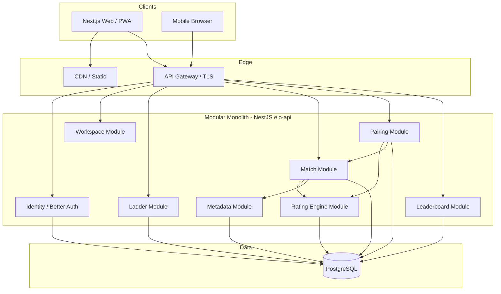
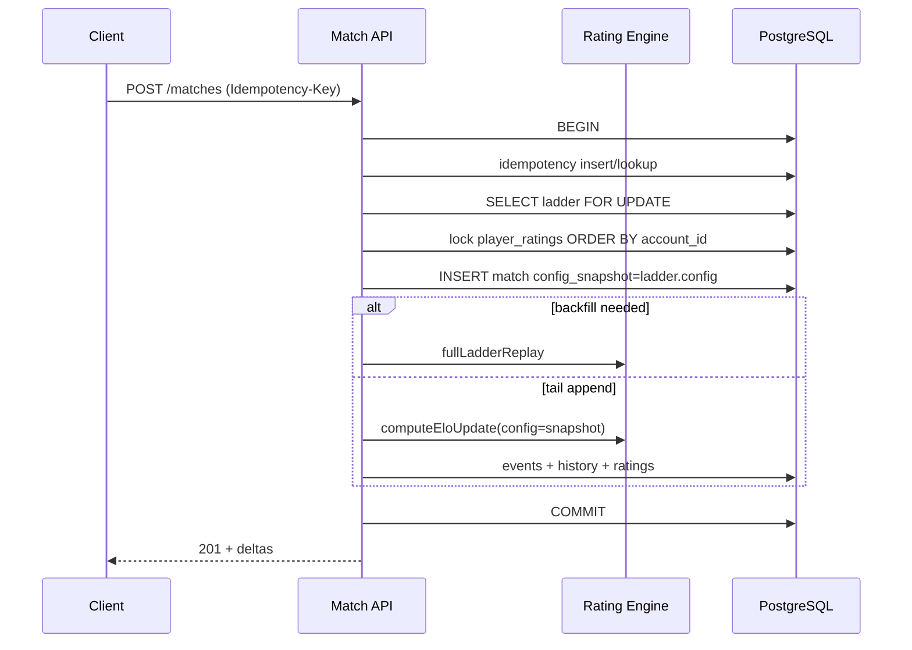
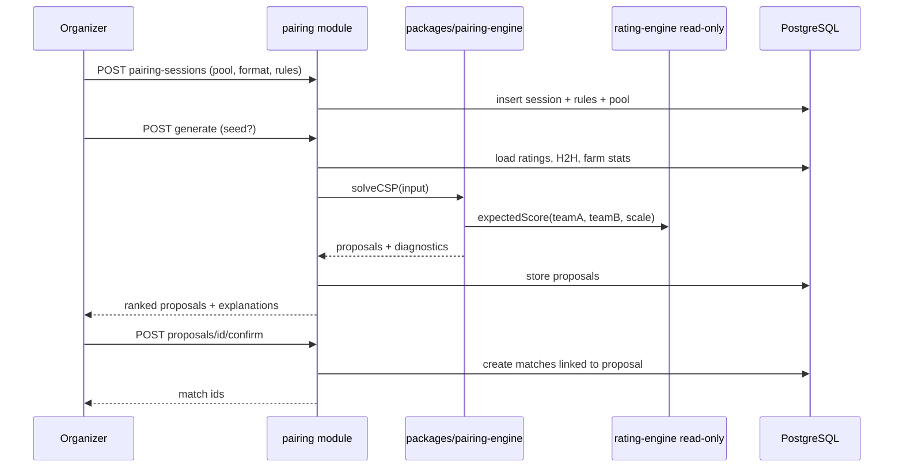
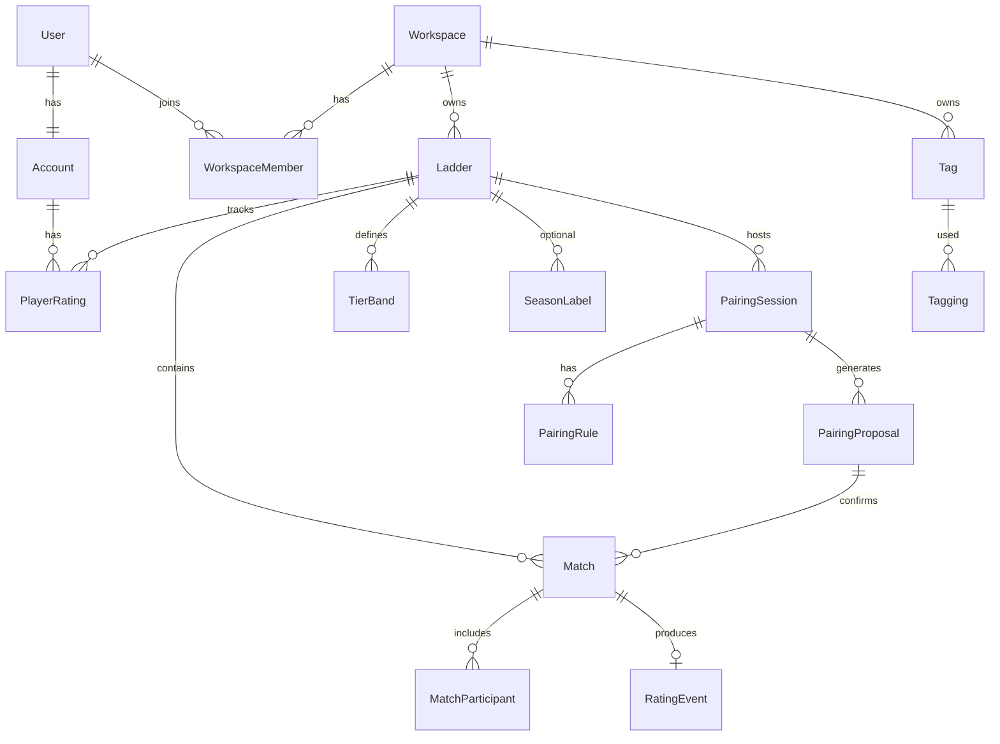

# ELO-everything 系统设计文档

| 字段 | 内容 |
|------|------|
| **Document** | ELO-everything Product & System Design |
| **Author** | TBD |
| **Date** | 2026-07-14 |
| **Status** | Draft |
| **Version** | 0.3.1 |
| **Audience** | Senior engineers implementing v1 |
| **Changelog** | 0.2 / 0.2.1 — review 与 rebuild。**0.3.0** — 配对 CSP。**0.3.1** — 冻结默认 preset=`fair`；farm 窗确认；池 32 为 v1 同步求解上限；补充 **大规模配对扩展（分桶/分层/近似）** 与数学复杂度说明 |

---

## Overview

**ELO-everything** 是一款多租户 SaaS Web 应用，提供**足够通用**的成对比较（pairwise / team-vs-team）评级机制：凡是能在一致规则下归纳为 Side A vs Side B 的竞技场景——**1v1 / 2v2 / NvN（等规模）**——均可产出 Elo 评分。评分**按账户（Account）**在特定 **Ladder（天梯/评级上下文）** 中存储；在统计约束下，运营方可自定义 **K-factor（步长）**、**起始分** 与 **段位阈值**。产品将 **命名、标签、备注与自定义字段** 作为一等能力，使比赛、天梯与实体保持人类可读、可检索。

除记分外，v1 提供 **局内配对（Session Pairing）**：在选定 player 池上配置 **组队 / 禁组 / 禁对阵** 等规则，用 **硬约束 + 多目标代价 + 可复现随机** 生成科学配对（尽量避免实力碾压、重复对阵刷分、固定抱团），确认后再落成 Match。**不是** 7×24 在线匹配队列。

v1 采用 **Modular Monolith**：单一可部署服务（**NestJS + Drizzle + PostgreSQL + Next.js + Better Auth**），按域划分边界。评级引擎与配对引擎均为**纯函数 + 明确事务边界**；外围 REST + Web；SSE 仅单实例 beta。

---

## Background & Motivation

### 现状痛点

1. **专用评级工具碎片化**：棋类、电竞、桌游、办公室 foosball 各自有脚本或小工具，规则不可配置、跨场景不可复用。
2. **团队赛支持薄弱**：经典 Elo 原生只覆盖 1v1；2v2/NvN 的聚合与分差分配 ad-hoc，易导致分数膨胀或不可解释。
3. **配置失控**：开放 K/起始分而无约束时，出现「一场跳 500 分」或段位阈值颠倒。
4. **缺乏审计与纠错**：误录后无法 void/correct；历史不可重建。
5. **元数据贫乏**：只有数字，没有标签、备注、命名体系，无法形成「人能读懂的天梯」。
6. **配对黑箱 / 人情局**：谁跟谁队、谁对谁靠口头；纯随机易「强队碾压弱队」（炸鱼）、固定几人对刷（刷分）；完整瑞士制又过重。

### 机会

把「可比较的事物」统一抽象为 **Match under Ladder Rules**，用可解释 Elo 引擎 + 强校验配置 + 富元数据 + **可解释的约束随机配对**，服务从朋友局到小型联赛。

---

## Goals & Non-Goals

### Goals（v1）

| ID | Goal |
|----|------|
| G1 | 支持 1v1、2v2、等规模 NvN（N≤8）的 SideA vs SideB 评级更新 |
| G2 | 每账户在每个 Ladder 上有独立 current rating + 完整 rating history |
| G3 | 可配置 K、scale、start_rating、floor、provisional、tier bands；硬/软统计约束 + 校准表 |
| G4 | 比赛录入、void、correction（单次 rebuild）均可审计；幂等；按 rating causal order 重放 |
| G5 | Workspace 多租户；RBAC；Ladder/Match/Account **一等** tags / notes / custom fields |
| G6 | Leaderboard、个人 rating 曲线、基础统计（W/L/D） |
| G7 | 移动端友好快速记分（含 offline draft + Idempotency-Key） |
| G8 | Modular monolith 单区域部署；PostgreSQL 主存储 |
| G9 | **局内配对**：选定 player 池 → 配置对阵/组队规则 → **科学随机** 生成建议 → 确认后创建 match |
| G10 | 配对显式优化：**实力接近、避免近期重赛、抑制刷分与炸鱼、尊重 must/cannot**；输出可解释质量分 |

### Non-Goals（v1 明确不做）

| ID | Non-Goal |
|----|----------|
| NG1 | 真金白银赌博 / 奖金结算 / 支付 |
| NG2 | **持续在线匹配队列**（排队自动开黑等）。**局内 Pairing Session 在 G9 内**，与 NG2 不冲突 |
| NG3 | TrueSkill / 专利相关实现（配对可用 Elo 期望分，不引入 TrueSkill 更新） |
| NG4 | 视频回放、裁判证据链 |
| NG5 | 跨 Workspace 全局统一评分 |
| NG6 | **FFA / 多方有序名次**：引擎 **拒绝** `format: ffa`；不实现 pairwise expansion |
| NG7 | 微服务拆分、多区域多活 |
| NG8 | 原生移动 App（PWA / 响应式 Web） |
| NG9 | **Season 作用域评分 / season reset**：Season 仅为 match 上的可选标签；不改 `player_ratings` 粒度（见 KD3） |
| NG10 | **Glicko-2 引擎与 schema 列**：研究 backlog；v1 不实现、不预留半成品路径 |
| NG11 | 不等规模队伍（3v2 等） |
| NG12 | 异步 job 队列上的大规模 rebuild（v1 **仅同步 rebuild** + 场次硬上限；异步 = v1.1） |
| NG13 | 多实例 SSE fanout（v1 SSE 假设单 API 实例；多实例时关闭或仅靠轮询） |
| NG14 | 完整 FIDE 瑞士制（色子/颜色平衡等）；可借鉴「不重复对手 + 分档」思想 |
| NG15 | 设备指纹级反作弊；smurf 仅 ladder 内**统计启发式** |

---

## Key Decisions

| # | Decision | Rationale |
|---|----------|-----------|
| KD1 | **引擎仅 Elo-pure + Team Average**；Glicko/TrueSkill 不进 v1 代码路径 | 可解释、可审计；避免半成品 schema |
| KD2 | **Team rating = 成员 rating 算术平均**；每位成员获得与队伍相同的 **完整 team Δ**（**不是 Δ/n**）；同 side 全员 `delta` 相等 | 与 1v1 同量级波动；零和为 \(n\Delta_A+n\Delta_B=0\)；「均分」一词禁用，改称 **equal full-Δ** |
| KD3 | **评级上下文 = Ladder only**；Season = 可选 match 标签（筛选/展示），**无** season-scoped ratings、**无** reset | 避免 PR-04 后破坏性迁移；Open Q 中「赛季重置」延后 v1.1+ |
| KD4 | **冻结栈：NestJS + Drizzle ORM + PostgreSQL 16 + Next.js (App Router) + Better Auth（cookie session）+ pnpm monorepo** | 消除「或类似」歧义；cookie 同源 BFF 模式见 §10 |
| KD5 | **锁序：`ladders` 行 `FOR UPDATE` → `player_ratings` 按 `account_id ASC` `FOR UPDATE`**；禁止颠倒 | 防死锁；多实例共用 PG 行锁即可 |
| KD6 | **append-only match + rating_events**；correction = 原子 void+insert 或 void 后新建；**一次** rebuild | 可审计 |
| KD7 | **硬约束拒绝 + 软约束须 `accept_soft_warnings: true` 才可保存** | 防静默接受病理配置 |
| KD8 | **REST only**；SSE 仅 `leaderboard_version`，**v1 单实例** | 降低复杂度 |
| KD9 | **Better Auth：邮箱+密码 session cookie**；社交 OAuth **延期**；Workspace RBAC | 与 PR-05 一致 |
| KD10 | 等规模队伍 only；N∈[1, max_team_size≤8] | 正确性优先 |
| KD11 | **`numeric(12,4)` + `quantize4` = decimal half-away-from-zero（半远离零）到 4 位** | 正负 tie 行为明确；strict 下对 A quant 后 `Δ_B=−Δ_A` |
| KD12 | **Idempotency-Key**：客户端每 draft 一个 UUID；服务端保留 ≥24h；同 key 不同 body → **409** | 弱网安全 |
| KD13 | **Rating causal order** = `(played_at ASC, sequence_no ASC)`；backfill / void / mid-correct 触发 **full ladder replay**（见 KD21） | 历史语义 + 实现简单 |
| KD14 | **`zero_sum_mode`：`strict`（默认）与 `soft` 均有精确定义**（见 §3.1） | 消除未定义配置面 |
| KD15 | **Floor/ceiling：在 raw+MOV+K 对齐之后 clamp**；任一 clamp 改变 delta ⇒ `zeroSum: false` | 诚实报告；不静默破坏零和叙事 |
| KD16 | **v1 rebuild 同步全量重放**；`COUNT(status=rated) > 5000` 时 **非尾部** void/correct/backfill → 413；**因果尾** void/correct 可用廉价逆操作（§3.9）；async = v1.1 | 无 worker 时不假装 async |
| KD17 | **`accounts.handle` 全局 `CITEXT UNIQUE`**；展示名可重复 | 冻结 PR-04 schema |
| KD18 | **FFA 不进 engine package v1**；API 校验拒绝 | 保护 M0 与确定性 |
| KD19 | **Metadata 一等**：Match create 可带 tags；**PR-08 metadata 先于 PR-09 match apply** | 满足 G5 |
| KD20 | **Correction API**：`POST /matches/{id}/correct` 原子替换 + 单次 rebuild | 兑现 G4 |
| KD21 | **v1 唯一 rebuild 算法 = Full ladder replay**（重置全部 `player_ratings` 聚合 → 按因果序重放所有 non-void match）；`CausalCursor` 仅用于 UI/日志 impact 估算，**不**做部分状态恢复 | 消除 partial-from-cursor 与 full-reset 矛盾 |
| KD22 | **每场 match 冻结 `config_snapshot`**；apply/rebuild **必须**用 snapshot，禁止读当前 `ladders.config` | 配置变更不改写历史 hash |
| KD23 | **期望分用 IEEE-754 `10 ** x` / `Math.pow(10,x)`**；golden 由参考脚本生成，不用手算 0.75 近似 | 与 TS 实现一致 |
| KD24 | **Rebuild 崩溃恢复**：优先单事务；否则 `rebuilding` + 启动/admin 强制 full replay 收尾；`POST /ladders/{id}/rebuild` | 禁止半重置外露 |
| KD25 | **局内配对 ≠ 在线队列**：Pairing 为 session 内对选定 pool 的建议；不占 NG2 | 产品边界清晰 |
| KD26 | **配对算法 = Constrained Stochastic Pairing (CSP)**：硬约束 + 多目标 cost + 温度采样 | 可解释、多样、seed 可复现 |
| KD27 | **硬约束优先**：must_team / cannot_team / cannot_oppose 不可静默降级；不可行 → 422 | 运营信任 |
| KD28 | **软目标默认权重**：平衡性 > 防炸鱼 > 防刷分/重赛 > 队内方差 > 随机噪声 | 科学默认，可配置 |
| KD31 | **默认 pairing preset = `fair`**；`strict_anti_farm` / `party_fun` / `swiss_like` 可选 | 产品确认：泛化朋友局优先 |
| KD32 | **v1 `max_pool_size=32` 为同步精确/近优求解上限**；更大池走 §4A.9 分桶/分层近似，不宣称「一次全局最优无限人」 | 组合爆炸；见复杂度 |
| KD29 | **配对只产出 proposal**；确认后才创建 match | 与记分事务解耦 |
| KD30 | **防炸鱼/刷分在配对层 + 观测层**，不修改 Elo 公式 | 保持引擎纯净（KD1） |

---

## Proposed Design

### 1. 高层架构



**部署假设 v1**：1 个 API 进程（或滚动更新单 active writer 可接受短暂双实例——依赖 PG 锁，**不**依赖进程内 SSE fanout）。Web 与 API **同站**（`app.example.com` + `/api` 反代）以简化 cookie/CSRF。

### 2. 模块边界

| Module | 职责 | 依赖 |
|--------|------|------|
| `identity` | User, Better Auth session | — |
| `workspace` | Workspace, membership, RBAC, `WorkspaceGuard` | identity |
| `ladder` | Ladder, config, tier bands；Season **标签表**（可选） | workspace |
| `match` | Match CRUD, void, correct, backfill rebuild 触发 | ladder, metadata, engine |
| `rating-engine` | 纯计算 + apply 事务适配 | ladder, match 输入 |
| `metadata` | tags, notes, custom fields | workspace |
| `leaderboard` | 排序查询；可选进程内 SSE | rating 读模型 |
| `pairing` | PairingSession、规则、CSP 求解、proposal 确认 → match | ladder, match, rating-engine(只读 E) |

规则：仅 `rating-engine` 适配层写 `player_ratings` / `rating_events`。`pairing` **只读** ratings，写 `pairing_*` 与可选 match 创建。

### 3. 评级引擎领域

#### 3.1 核心数学：1v1 Elo

\[
E_A = \frac{1}{1 + 10^{(R_B - R_A)/\text{scale}}}
\]

\[
R'_A = R_A + K_{\text{eff}} \cdot (S_A - E_A),\quad
R'_B = R_B + K_{\text{eff}} \cdot (S_B - E_B)
\quad \text{（strict 模式）}
\]

- \(S \in \{1, 0.5, 0\}\)：胜 / 平 / 负；`allow_draw=false` 时拒绝 draw。
- **Effective K（单人）**：`gamesPlayed < provisional_games` → `k_provisional`，否则 `k_factor`。

##### `zero_sum_mode` 精确定义

| Mode | 行为 | `RatingComputationResult.zeroSum` |
|------|------|-----------------------------------|
| **`strict`（默认）** | 1v1：先算 \(K_A=\mathrm{effK}(A)\)、\(K_B=\mathrm{effK}(B)\)，再 \(K_{\text{eff}}=\mathrm{policy}(K_A,K_B)\)（`min`\|`avg`\|`max`，默认 `min`）。\(\Delta_A = \mathrm{quant}(K_{\text{eff}}(S_A-E_A)\cdot M)\)，\(\Delta_B = -\Delta_A\)（量化后强制对称，见 §3.2 伪代码）。Team：同一算法。 | `true` **当且仅当** 无 floor/ceiling clamp 改变任何 delta |
| **`soft`** | 每侧使用**自己的** K（1v1：\(K_A,K_B\) 各自；team：各自 `K_team`），**不做** asymmetric 对齐、**不**强制 \(\Delta_B=-\Delta_A\)。总 ladder 点数可漂移。 | **恒为 `false`** |

`soft` 用途：实验性「新手高 K 不影响老手扣分幅度」；运营需接受通胀/通缩；指标 `ladder_mean_rating` 必看。

#### 3.2 Team NvN — equal full-Δ（非 Δ/n）

**规则（规范性）**：

1. \(R_A^{\text{team}} = \frac{1}{n}\sum_i R_{A_i}\)，\(R_B^{\text{team}}\) 同理。
2. \(E_A = 1/(1+10^{(R_B^{\text{team}}-R_A^{\text{team}})/\text{scale}})\)，\(E_B=1-E_A\)。
3. 每位成员获得 **与队伍级 Δ 相同的完整值**，**不是**将 Δ 除以 n：
   \[
   R'_{A_i} = R_{A_i} + \Delta_A \quad \forall i,\qquad
   R'_{B_j} = R_{B_j} + \Delta_B \quad \forall j
   \]
4. Strict 下 \(\Delta_B = -\Delta_A\)，全场 \(\sum\Delta = n\Delta_A + n\Delta_B = 0\)（clamp 前）。
5. 可选 v1.1 config：`team_delta_mode: 'full' | 'divide_by_n'`；**v1 仅实现 `full`**，配置面不暴露 `divide_by_n`。

**为何 average 而非 sum**：sum 随 n 放大队伍分差，使 \(E\) 与 1v1 不可比（8v8 极高/极低期望）；average 保持与 1v1 相同 rating 量纲，便于统一 K 校准与 UX 解释。Equal full-Δ 使 NvN 单场个人波动与 1v1 同量级；若产品未来嫌 8v8 过抖，应调低 K 或引入 `divide_by_n`，而非默默除 n。

##### Team 路径完整算法（规范性伪代码）

```typescript
// engine_version: "elo-team-avg-1"
function computeTeamElo(input: MatchResultInput): RatingComputationResult {
  const { config, sides, winnerSide, preStates } = input;
  const sideA = sides.find(s => s.side === 'A')!;
  const sideB = sides.find(s => s.side === 'B')!;
  const n = sideA.participantAccountIds.length;
  assert(n === sideB.participantAccountIds.length && n >= 1);

  const ratingsA = sideA.participantAccountIds.map(id => preStates.get(id)!.rating);
  const ratingsB = sideB.participantAccountIds.map(id => preStates.get(id)!.rating);
  const teamA = mean(ratingsA);
  const teamB = mean(ratingsB);
  const expectedA = 1 / (1 + 10 ** ((teamB - teamA) / config.scale));
  const actualA = winnerSide === 'draw' ? 0.5 : winnerSide === 'A' ? 1 : 0;
  const actualB = 1 - actualA; // draw: 0.5

  // Member effective Ks
  const kMembersA = sideA.participantAccountIds.map(id =>
    effectiveK(config, preStates.get(id)!.gamesPlayed));
  const kMembersB = sideB.participantAccountIds.map(id =>
    effectiveK(config, preStates.get(id)!.gamesPlayed));

  const kTeamA = aggregateTeamK(config.team_k_aggregation, kMembersA, config.k_factor);
  const kTeamB = aggregateTeamK(config.team_k_aggregation, kMembersB, config.k_factor);

  let movM = marginMultiplier(config, sideA.score, sideB.score, winnerSide);
  // marginMultiplier: null score → 1; draw → 1; else clamp formula

  let deltaA: number;
  let deltaB: number;
  let kEffReported: number;

  if (config.zero_sum_mode === 'strict') {
    const kEff = asymmetricPolicy(config.asymmetric_k_policy, kTeamA, kTeamB);
    kEffReported = kEff;
    // Step order: K*(S-E) → *MOV → quantize4 (half-away-from-zero) → force Δ_B = -Δ_A
    const rawA = kEff * (actualA - expectedA) * movM;
    deltaA = quantize4(rawA);
    deltaB = quantize4(-deltaA); // exact negation after quant of A (not independent quant of rawB)
  } else {
    // soft: independent K per side
    kEffReported = kTeamA;
    deltaA = quantize4(kTeamA * (actualA - expectedA) * movM);
    deltaB = quantize4(kTeamB * (actualB - (1 - expectedA)) * movM);
  }

  const deltas: PlayerRatingDelta[] = [];
  for (const id of sideA.participantAccountIds) {
    const pre = preStates.get(id)!;
    let after = pre.rating + deltaA;
    let d = deltaA;
    const clamped = applyFloorCeiling(after, config);
    if (clamped !== after) {
      d = quantize4(clamped - pre.rating);
      after = clamped;
    }
    deltas.push({
      accountId: id, side: 'A',
      ratingBefore: pre.rating, ratingAfter: after, delta: d,
      kEffective: config.zero_sum_mode === 'strict' ? kEffReported : kTeamA,
      expectedScore: expectedA, // team-level E for all members
      actualScore: actualA,
    });
  }
  for (const id of sideB.participantAccountIds) {
    const pre = preStates.get(id)!;
    let after = pre.rating + deltaB;
    let d = deltaB;
    const clamped = applyFloorCeiling(after, config);
    if (clamped !== after) {
      d = quantize4(clamped - pre.rating);
      after = clamped;
    }
    deltas.push({
      accountId: id, side: 'B',
      ratingBefore: pre.rating, ratingAfter: after, delta: d,
      kEffective: config.zero_sum_mode === 'strict' ? kEffReported : kTeamB,
      expectedScore: 1 - expectedA,
      actualScore: actualB,
    });
  }

  const sumDelta = deltas.reduce((s, x) => s + x.delta, 0);
  const zeroSum =
    config.zero_sum_mode === 'strict' &&
    quantize4(sumDelta) === 0; // false if any clamp broke sum

  return {
    matchId: input.matchId,
    engine: 'elo',
    engine_version: 'elo-team-avg-1',
    zeroSum,
    teamRatingA: teamA,
    teamRatingB: teamB,
    expectedA,
    movMultiplier: movM,
    deltas,
    computationHash: hashComputation(/* see §3.8 */),
  };
}

function aggregateTeamK(
  mode: 'avg_member_k' | 'min_member_k' | 'fixed',
  memberKs: number[],
  fixedK: number,
): number {
  if (mode === 'fixed') return fixedK;
  if (mode === 'min_member_k') return Math.min(...memberKs);
  return mean(memberKs); // avg_member_k default
}

function asymmetricPolicy(policy: 'min' | 'avg' | 'max', kA: number, kB: number): number {
  if (policy === 'max') return Math.max(kA, kB);
  if (policy === 'avg') return (kA + kB) / 2;
  return Math.min(kA, kB);
}
```

**1v1** 是 `n=1` 的同一算法特例（可共用代码路径）。

**`expectation_mode: pairwise_mean`**：v1 **不实现**（移出 config 默认；若 JSON 出现则硬拒绝）。减少未测路径。

**`kEffective` 审计语义**：strict 下所有成员报告 **对齐后的 `K_eff`**（非个人 provisional K）；soft 下报告该侧 `K_team`。个人 provisional 状态仍由 `games_played` / `provisional` 列表达。

##### Worked example：非对称 provisional K（team）

Config: scale=400, k_factor=32, k_provisional=40, provisional_games=20,  
`team_k_aggregation=avg_member_k`, `asymmetric_k_policy=min`, `zero_sum_mode=strict`, MOV off.

| Player | Side | R | gamesPlayed | effK |
|--------|------|---|-------------|------|
| P1 | A | 1500 | 5 | 40 |
| P2 | A | 1600 | 50 | 32 |
| P3 | B | 1550 | 30 | 32 |
| P4 | B | 1450 | 30 | 32 |

- \(R_A=1550\), \(R_B=1500\)
- \(E_A = 1/(1+10^{((1500-1550)/400)}) = 1/(1+\mathtt{Math.pow}(10,-0.125)) \approx 0.5714631174\)（IEEE-754，**非**手算 \(10^{-0.125}=0.75\)）
- \(K_{\text{team},A}=(40+32)/2=36\), \(K_{\text{team},B}=32\)
- \(K_{\text{eff}}=\min(36,32)=32\)
- A 胜：raw \(\Delta_A=32\times(1-E_A)\approx 13.71318024\) → **`quantize4` → 13.7132**
- \(\Delta_B=-13.7132\)

每人：P1/P2 +13.7132；P3/P4 −13.7132。`SUM=0`，`zeroSum=true`。

#### 3.3 FFA

**v1 不实现。** `format` 枚举仅 `'1v1' | '2v2' | 'nvn'`。引擎与 API 对未知 format 返回 400。未来若做 FFA：冻结 preStates 同时算所有 pair、按 `(accountId_i, accountId_j)` 字典序、再汇总 delta——仅作为 v2 设计备忘，**不进 PR-02/03**。

#### 3.4 Margin of Victory

\[
M = \mathrm{clamp}\big(1 + \alpha \cdot \tanh(\beta \cdot |score_a - score_b|),\; m_{min},\; m_{max}\big)
\]

| 条件 | M |
|------|---|
| `margin_of_victory.enabled === false` | 1 |
| `score_a` 或 `score_b` 为 `null`/缺失 | 1 |
| `winner_side === 'draw'` | 1 |
| 否则 | 上式；**硬约束** `m_max ≤ 2.0` |

默认：`α=0.5, β=0.1, m_min=1.0, m_max=1.5`。  
**分数单位**由 ladder 自解释（球、局、分），引擎不做 format 语义校验。  
**顺序**：`K*(S-E)` → `×M` → quantize →（strict）对称 → floor/ceiling clamp。

#### 3.5 参数模型 `RatingConfig`

```typescript
export interface RatingConfig {
  engine: 'elo'; // v1 唯一合法值
  scale: number;
  start_rating: number;
  k_factor: number;
  k_provisional: number;
  provisional_games: number;
  rating_floor: number | null;
  rating_ceiling: number | null;
  allow_draw: boolean;
  zero_sum_mode: 'strict' | 'soft';
  asymmetric_k_policy: 'min' | 'avg' | 'max';
  team_k_aggregation: 'avg_member_k' | 'min_member_k' | 'fixed';
  margin_of_victory: {
    enabled: boolean;
    alpha: number;
    beta: number;
    m_min: number;
    m_max: number;
  };
}

export interface TierBand {
  id: string;
  name: string;
  min_rating: number;
  max_rating: number | null;
  color?: string;
  sort_order: number;
}
```

**已移除 v1 config 字段**：`expectation_mode`, `glicko`, `team_delta_mode`（后者仅文档预留）。

#### 3.6 统计约束、校验与校准

##### 硬约束（400，拒绝保存）

| 参数 | 硬范围 |
|------|--------|
| `scale` | [100, 1000] |
| `start_rating` | [0, 5000] |
| `k_factor` | **[1, 64]** |
| `k_provisional` | [1, 128] 且 ≥ `k_factor` |
| `provisional_games` | [0, 100] |
| `rating_floor` | null 或 [0, start_rating] |
| `rating_ceiling` | null 或 ≥ start_rating |
| `m_max` | ≤ 2.0 且 ≥ `m_min` ≥ 1.0 |
| tier bands | `min` 严格递增、区间半开无重叠；覆盖 `[floor ?? 0, ceiling ?? +∞)` |
| **start ∈ tiers** | 当 `tier_bands.length > 0` 时，`start_rating` 必须落在某一 band 内 |
| `engine` | 必须为 `'elo'` |

##### 软约束（须 `accept_soft_warnings: true` 否则 400）

| 条件 | severity | 说明 |
|------|----------|------|
| `k_factor > 40` | warn | 已建立玩家波动大 |
| `k_factor < 8` | warn | 收敛慢 |
| `k_provisional > 64` | warn | 定级剧烈 |
| `start_rating` ∉ [1000, 2000] | warn | 可读性 |
| `provisional_games < 5` 且 `k_provisional ≥ 40` | warn | 定级不稳 |
| tier 宽度 < 50 | warn | 段位抖 |

`PATCH /ladders/{id}/config` body：

```json
{
  "config": { "...": "..." },
  "tier_bands": [ "... optional full replace ..." ],
  "accept_soft_warnings": true
}
```

若存在 soft warnings 且 flag 不为 true → **400** + `warnings[]`。硬错误永远 400。

##### 校准表（presets，|Δ| 在 strict、无 MOV、无 clamp）

公式（scale=400，IEEE-754）：低方胜时  
\(E = 1/(1+10^{(\Delta R)/\text{scale}})\)，\(\Delta = K(1-E)\)，再 `quantize4`。  
极端 upset \(E\to 0\) 时 \(|\Delta|_{\max}\approx K\)。

| Preset | K | 均势胜（ΔR=0）\|Δ\| | 低 200 分爆冷胜 \|Δ\| | 低 400 分爆冷胜 \|Δ\| |
|--------|---|---------------------|----------------------|----------------------|
| `chess_like` | 32 | 16.0000 | 24.3119 | **29.0909** |
| `stable` | 16 | 8.0000 | 12.1560 | **14.5455** |
| `volatile_party` | 40 | 20.0000 | 30.3899 | **36.3636** |
| `foosball_2v2` | 32 | 同 chess_like（team full-Δ） | 同左 | 同左 |

参考：ΔR=200 → \(E\approx0.24025307\)；ΔR=400 → \(E=1/11\approx0.09090909\)。  
UI 模拟器与 golden **必须**用同一参考脚本生成，禁止手抄近似。

##### 通胀诊断

- Metric gauge：`ladder_mean_rating{ladder_id}`（每次 apply 后更新或定时）  
- Alert 建议：30 天均值漂移 > 50 分且 `soft` 或高 clamp 率  

#### 3.7 Effective K

```typescript
function effectiveK(cfg: RatingConfig, gamesPlayedInLadder: number): number {
  return gamesPlayedInLadder < cfg.provisional_games
    ? cfg.k_provisional
    : cfg.k_factor;
}
```

#### 3.8 引擎接口与 `computation_hash`

```typescript
export const ENGINE_VERSION = 'elo-team-avg-1' as const;

export interface PlayerRatingState {
  accountId: string;
  rating: number; // 4 dp
  gamesPlayed: number;
  provisional: boolean;
}

export interface MatchSideInput {
  side: 'A' | 'B';
  participantAccountIds: string[];
  score?: number | null;
}

export interface MatchResultInput {
  matchId: string;
  ladderId: string;
  format: '1v1' | '2v2' | 'nvn';
  sides: [MatchSideInput, MatchSideInput];
  winnerSide: 'A' | 'B' | 'draw';
  playedAt: string;
  config: RatingConfig;
  preStates: Map<string, PlayerRatingState>;
}

export interface PlayerRatingDelta {
  accountId: string;
  side: 'A' | 'B';
  ratingBefore: number;
  ratingAfter: number;
  delta: number;
  kEffective: number;
  expectedScore: number; // team-level
  actualScore: number;
}

export interface RatingComputationResult {
  matchId: string;
  engine: 'elo';
  engine_version: typeof ENGINE_VERSION;
  zeroSum: boolean;
  teamRatingA: number;
  teamRatingB: number;
  expectedA: number;
  movMultiplier: number;
  deltas: PlayerRatingDelta[];
  computationHash: string;
}

export function computeEloUpdate(input: MatchResultInput): RatingComputationResult;

export interface RatingEnginePort {
  preview(input: MatchResultInput): RatingComputationResult;
  apply(cmd: ApplyMatchCommand): Promise<ApplyMatchResult>;
  voidMatch(matchId: string, reason: string, actorAccountId: string): Promise<void>;
  correctMatch(matchId: string, body: CreateMatchBody, actorAccountId: string): Promise<ApplyMatchResult>;
  /** v1: always full ladder replay; `impactFrom` is optional UI/logging only */
  rebuildLadder(ladderId: string, impactFrom?: CausalCursor): Promise<{ eventsRebuilt: number }>;
  /** Cheap inverse of causal-tail apply; see §3.9 */
  voidTailMatch(matchId: string, reason: string, actorAccountId: string): Promise<void>;
}

export interface CausalCursor {
  playedAt: string;
  sequenceNo: number;
}
```

##### Canonical hash（规范性）

1. 构造 payload 对象（仅下列字段，**无**未定义键）：
   - `engine_version`, `matchId`, `ladderId`, `format`, `winnerSide`
   - `config`：该场 **`config_snapshot`**（`RatingConfig` 键名字典序）
   - `participants`：按 `accountId` 升序数组，每项 `{ accountId, side, ratingBefore, gamesPlayed }`
   - `result`：`{ teamRatingA, teamRatingB, expectedA, movMultiplier, zeroSum, deltas: [...] }`  
     `deltas` 按 `accountId` 升序；数值字段均为 **字符串** 形式的 4 位小数（如 `"1513.7132"`），布尔为 JSON boolean
2. `JSON.stringify` 使用 **键排序** 的稳定序列化（如 `json-stable-stringify`）
3. `computationHash = SHA-256(utf8 bytes)` 小写 hex  
4. Golden fixtures 由 **参考脚本**（同 `Math.pow`）生成并提交 hex

##### `quantize4`（规范性）

```typescript
/** Half-away-from-zero to 4 decimal places (not banker's; not "half toward +∞"). */
export function quantize4(x: number): number {
  // Prefer decimal.js / Prisma Decimal; illustrative:
  // ROUND_HALF_UP in IEEE decimal = away from zero on ties for both signs.
  const factor = 10_000;
  const scaled = x * factor;
  const rounded = scaled >= 0
    ? Math.floor(scaled + 0.5)
    : Math.ceil(scaled - 0.5);
  return rounded / factor;
}
```

单元测试至少：`quantize4(1.23455)===1.2346`，`quantize4(-1.23455)===-1.2346`，`quantize4(13.71315)===13.7132`。  
**禁止**将 half-up 描述为与「仅向 +∞」混用；文档统一称 **half-away-from-zero**。

##### 期望分数值（规范性）

```typescript
expectedA = 1 / (1 + Math.pow(10, (teamB - teamA) / config.scale));
```

`ENGINE_VERSION` notes 冻结：IEEE-754 double + 上述 `quantize4`；**不以** \(10^{-0.125}=3/4\) 手算。

#### 3.9 应用更新、因果序、Backfill、Void、Correction

##### Rating causal order（规范性）

对同一 `ladder_id`，评级因果全序：

\[
\text{order} = (played\_at \,\text{ASC},\, sequence\_no \,\text{ASC})
\]

- `sequence_no`：`BIGSERIAL`，**插入时分配**，打破 `played_at` 平局。
- voided match **不参与**重放流。

##### `config_snapshot` 绑定（规范性）— KD22

1. **Create match（首次 apply 前）**：  
   `config_snapshot := ladders.config`（深拷贝 JSON），并记录当时的 `ladders.config_version` 到 match 行（或快照内）。  
2. **`computeEloUpdate` 的 `config` 参数**：**永远**来自该 match 的 `config_snapshot`，**禁止**读取当前 `ladders.config`。  
3. **Rebuild 每一步**同 (2)。  
4. **`PATCH` ladder config** 只影响**之后**新创建的 match；不改写已有 `config_snapshot`，不触发自动 rebuild。  
5. Golden：K=32 apply → PATCH K=16 → void 另一场较晚 match → full replay → 早场 deltas/`computation_hash` 仍对应 K=32。

##### v1 唯一 rebuild 算法：**Full ladder replay**（KD21）

**规范性**：任何需要 rebuild 的路径（backfill 非尾部、void 非尾廉价路径之外、correct、admin rebuild、崩溃恢复）调用**同一**过程 `fullLadderReplay(ladderId)`：

```
function fullLadderReplay(ladderId):
  // Pre: caller holds ladders FOR UPDATE; status is or will be 'rebuilding'
  startRating := current_ladder.config.start_rating
    // Note: start_rating for *blank* rows uses CURRENT ladder config (initial seed only).
    // Match-level K/scale/etc. still come from each match.config_snapshot.

  1. Mark all non-superseded rating_events for ladder: superseded = true
     (keep rows for audit; do not delete)

  2. DELETE FROM rating_history WHERE ladder_id = ladderId
     // full replace; no orphan rows pointing at voided matches

  3. For every player_ratings row on ladder OR account that appears in any non-void match:
       rating = start_rating
       games_played = 0; wins = 0; losses = 0; draws = 0
       peak_rating = start_rating
       provisional = (0 < current_ladder.config.provisional_games)
     // Accounts only on voided-only history may keep a zero-game row at start_rating

  4. matches := SELECT * FROM matches
                WHERE ladder_id = ladderId AND status = 'rated'
                ORDER BY played_at ASC, sequence_no ASC
     // status 'voided' skipped; 'pending' must not exist mid-rebuild

  5. For each match m in matches:
       preStates := load player_ratings for participants (FOR UPDATE order by account_id)
       result := computeEloUpdate({
         ...,
         config: m.config_snapshot,   // NEVER ladders.config
         preStates
       })
       // assert result.computationHash == m.computation_hash
       //   OR if hash algorithm bumped: recompute and UPDATE m.computation_hash only under engine migration
       apply result to player_ratings:
         rating := ratingAfter
         games_played += 1
         W/L/D += according to actualScore / side
         provisional := games_played < snapshot_or_current provisional_games
           // v1: use m.config_snapshot.provisional_games
         peak_rating := max(peak_rating, ratingAfter)
       INSERT rating_history rows (one per participant)
       INSERT rating_events (event_type='apply' or 'rebuild', superseded=false) + entries
       UPDATE match SET computation_hash = result.computationHash if needed

  6. leaderboard_version += 1
  7. status := 'active'
```

**端口语义**：`rebuildLadder(ladderId, impactFrom?)` **始终**执行 `fullLadderReplay`；`impactFrom` **仅**用于响应字段 `rebuild.impact_estimate`（UI「约影响 N 场」），**不**改变重放起点。v1 **不做** partial state restore / checkpoint。

**voided 跳过**：重放流只含 `status='rated'`。

##### Backfill 策略（选 **B：flexible**）

| 场景 | 行为 |
|------|------|
| **尾部追加**（新 match 因果序最大） | 用当前 `player_ratings` 作 preState；`config_snapshot` 取当前 ladder config；单次 `computeEloUpdate`；**不** full replay |
| **中间插入 / 回填** | INSERT（`status=rated` 前）→ **`fullLadderReplay`**（含本场） |
| **void / correct**（非尾廉价路径） | 标记 void 后 → **`fullLadderReplay`** |

尾部判定：插入并分配 `sequence_no` 后，不存在其他 `status=rated` 行在因果序上严格更大。

##### 锁序与并发（规范性）

**尾部 apply**：

```
BEGIN;
SELECT * FROM ladders WHERE id = $ladderId FOR UPDATE;
-- status rebuilding → 409; archived → 403
SELECT * FROM player_ratings
 WHERE ladder_id = $ladderId AND account_id IN (...)
 ORDER BY account_id FOR UPDATE;
-- lazy insert missing rows at start_rating, then re-lock sorted
INSERT match with config_snapshot = ladders.config;
computeEloUpdate(config: match.config_snapshot);
write events, history, update ratings, match.computation_hash;
leaderboard_version += 1;
COMMIT;
```

**Full replay**：整段在 **同一 DB 事务** 内完成（v1 默认，见下节超时策略）；事务内保持 `ladders FOR UPDATE`。

##### 场次上限、尾部廉价 void、413 产品语义

设 \(M = \texttt{COUNT(*)} \texttt{ FROM matches WHERE ladder_id=? AND status='rated'}\)（**非** denormalized `rated_match_count` 列）。

| 操作 | \(M \le 5000\) | \(M > 5000\) |
|------|----------------|--------------|
| 尾部 apply | 允许 | 允许 |
| Backfill / 非尾 void / 非尾 correct | full replay | **413** `REBUILD_TOO_LARGE` |
| **因果尾** void / correct | full replay **或** 廉价逆操作（下） | **仅允许廉价逆操作**；否则 413 |

**因果尾**：match 在所有 `status=rated` 中 causal order **最大**。

**廉价尾部 void（`voidTailMatch`）** — 无需 full replay：

1. 权限同 void。  
2. 读取该 match 最新非 superseded `rating_events` + entries。  
3. 对每个 participant：`rating -= delta`（使用存储的 `delta`）；`games_played -= 1`；按 `actual_score` 回退 W/L/D；`provisional` 重算；**peak_rating 不回退**（v1 简化：peak 只增；完整 peak 修复需 full replay，文档标明）。  
4. `DELETE rating_history WHERE match_id = ?`。  
5. match → `voided`；原 apply event `superseded=true`；写 `event_type='void'`。  
6. `leaderboard_version += 1`。  

**廉价尾部 correct**：voidTail + 尾部 insert 新 match（两步同事务）或 correct 端点检测 tail 后走等价路径。

**产品/UX 文案**：413 =「该天梯场次过多，无法重算中部历史；可 void/纠正**最近一场**，或 archive 后新开 ladder / 等待 v1.1 异步重算」。API 错误体带 `code: REBUILD_TOO_LARGE` 与 `tail_void_allowed: true`。

##### `rebuilding` 状态、事务边界与崩溃恢复（KD24）

**默认路径（推荐）**：**单一数据库事务** 完成 full replay。

- 设置 `statement_timeout`（会话级）建议 **120s**；若预估 M 使 p95 超时，将 **软上限** 降为 **M≤1000** 触发 413（配置项 `rebuild_max_matches`，默认 5000，运维可调低）。  
- 单事务内：`status='rebuilding'` → replay → `status='active'`；失败 **ROLLBACK**，对外仍为 rebuild 前一致状态（`status` 回滚为 `active`）。

**仅当** 单事务不可行（超时反复）时的 **多语句协议**（仍同步、同请求）：

1. `UPDATE ladders SET status='rebuilding', rebuild_started_at=now() WHERE id=?` **并 COMMIT**（短事务）。  
2. 在后续事务中跑 `fullLadderReplay`（仍须 ladder 锁）；成功则 `status='active'`。  
3. **不变量**：一旦 `status='rebuilding'`，**禁止**接受会读/写 rating 的用户写操作（409）；leaderboard GET 返回 `stale: true`。  
4. **禁止**在步骤 1 之后、步骤 2 完成前对外暴露「已重置为 start_rating 的半成品」——实现上步骤 2 必须是原子 full replay；若步骤 2 失败，保持 `rebuilding`。

**恢复规则**：

| 触发 | 行为 |
|------|------|
| API 进程启动 | `SELECT id FROM ladders WHERE status='rebuilding'` → 对每个调用 `fullLadderReplay`（admin 身份系统 actor） |
| `POST /ladders/{id}/rebuild` | admin+；强制 `fullLadderReplay`；用于人工恢复或 hash 修复 |
| 用户 void/correct 遇 `rebuilding` | **409** |

PR-20 runbook：如何识别卡死 `rebuilding`、调 `rebuild_max_matches`、调用 rebuild 端点。

| API | `status=rebuilding` |
|-----|---------------------|
| POST matches / void / correct（非 recovery） | **409** `LADDER_REBUILDING` |
| GET leaderboard | **200** + `{ stale: true }` |
| POST `/ladders/{id}/rebuild` | 允许（admin） |

##### Void（非尾 / 通用）

1. 权限见 §7。  
2. 若 match 是因果尾 → 优先 `voidTailMatch`（任何 M）。  
3. 否则若 \(M>5000\)（void 前 rated 数）→ **413**。  
4. 否则：`status=voided`，写 void event → **`fullLadderReplay`**。  
5. 响应含 `rebuild: { performed: true, algorithm: "full_ladder_replay", matches_replayed: N }`。

##### Correction

**首选 API**：`POST /api/v1/matches/{id}/correct`

1. 权限：admin 任意；member/recorder 仅 `created_by=self`。  
2. 原 match → `voided`，`void_reason='corrected'`，`replaced_by_match_id=newId`。  
3. 插入新 match（`corrects_match_id=oldId`，新 Idempotency-Key，**新** `config_snapshot` = **当前** ladder.config）。  
4. 若 old 与 new **均为** 操作后因果流的尾部形态可走廉价路径；否则 **一次** `fullLadderReplay`。  
5. `rating_events`：`correct` 指针 event 可选；以 void + apply 序列为准。

##### Rebuild 对 `rating_history` / peak / W-L 的生命周期（规范性）

| 数据 | Full replay 行为 |
|------|------------------|
| `player_ratings.rating` | 从 `start_rating` 重放得到 |
| `games_played`, W/L/D | **仅**统计重放中的 rated matches；void 不计入 |
| `provisional` | `games_played < config_snapshot.provisional_games`（每场用该场 snapshot） |
| `peak_rating` | 重放过程中 `max(start_rating, each ratingAfter)` |
| `rating_history` | **DELETE 全 ladder** 后按重放顺序重插；无 void 残留 |
| `rating_events` | 旧 apply 标 `superseded=true`；写入新 apply/rebuild events |
| 廉价尾 void 后 peak | **不降低** peak（已知限制；文档 + 可选 admin full rebuild 修复） |

PR-11 测试：void 中间场 → history 点数 = rated 数 × 参与人次；peak 与手算一致；W/L 不含 void。

##### Idempotency

表 `idempotency_keys (workspace_id, key, request_hash, match_id, response_body JSONB, created_at)`：

- 同 key + 同 `request_hash` → **200** 返回存储的 `response_body`  
- 同 key + 不同 hash → **409** `IDEMPOTENCY_KEY_REUSE`  
- TTL：≥ **24h**

##### 序列图（尾部 apply）



### 4A. 配对领域（Session Pairing / CSP）— v0.3

> **定位**：在 **选定 player 范围** 内，按可配置规则做 **科学随机配对**，产出可解释的 Match 建议。  
> **不是**：全天在线 matchmaking queue（见 NG2）。

#### 4A.0 用户故事

1. 主办人在某 Ladder 上勾选今晚到场的玩家（或按 tag / 搜索过滤）。
2. 配置规则：如「A 与 B 必须同队」「C 不能对阵 D」「E 与 F 不能同队」。
3. 选择 format（1v1 / 2v2 / NvN）与策略 preset（公平优先 / 娱乐随机 / 严格防刷）。
4. **生成配对** → 1～k 套 proposal，含质量分与风险标签（`stomp` / `rematch` / `farm`）。
5. 选定一套 → **确认** → 创建 match；可 **换一批**（新 seed）或锁定部分后重抽。



#### 4A.1 概念模型

| 概念 | 说明 |
|------|------|
| **PairingSession** | 一次配对活动：`ladder_id`、format、team_size n、策略、seed、状态 |
| **PairingPool** | 参与账户集合（显式 account_ids 快照） |
| **PairingRule** | 组队/对阵规则（硬/软） |
| **PairingProposal** | 一套完整分边（若干 MatchDraft）+ cost 分解 + 风险标签 |
| **MatchDraft** | 单场 side A/B；确认后变成 `matches` 行 |

状态机：`draft` → `generated` → `confirmed` | `cancelled`；可多次 re-generate（新 seed，旧 proposal 保留审计）。

#### 4A.2 规则类型

| `type` | 语义 | 默认硬度 |
|--------|------|----------|
| `must_team` | 列出的账户必须同 side（人数 ≤ n） | **hard** |
| `cannot_team` | 两人禁止同 side | **hard** |
| `cannot_oppose` | 两人禁止分在对立 side | **hard** |
| `must_oppose` | 两人必须对立（同场） | hard（可 soft） |
| `prefer_team` / `prefer_oppose` | 希望同队/对阵 | **soft** + weight |
| `locked_side` | 锁定在 A/B（局部重抽） | hard |

**冲突检测**：`must_team` 并查集合并；`cannot_team` 为禁边；不可行 → **422 `PAIRING_INFEASIBLE`** + `conflicts[]`。**禁止**静默丢弃 hard 规则。

#### 4A.3 `PairingPolicy`（可配置）

```typescript
interface PairingPolicy {
  w_balance: number;        // default 1.0  — |E-0.5|（公平核心）
  w_rating_gap: number;     // default 0.8  — |RA-RB|/scale
  w_team_spread: number;    // default 0.4  — 队内 max-min（防 stack）
  w_rematch: number;        // default 0.7
  w_farm: number;           // default 0.9
  w_stomp: number;          // default 1.0
  w_partner_repeat: number; // default 0.3
  temperature: number;      // default 0.15, [0.01, 1.5]
  max_imbalance: number;    // default 0.35 → E ∈ [0.15, 0.85]
  max_team_rating_gap: number;   // default 2*scale
  max_cross_player_gap: number | null; // default scale
  rematch_window_matches: number; // default 3
  farm_window_days: number;       // default 14
  farm_max_meetings: number;      // default 3
  farm_winrate_threshold: number; // default 0.75
  provisional_isolation: boolean; // default true
  candidate_samples: number;      // default 200
  max_pool_size: number;          // default 32
  top_k_proposals: number;        // default 5
}
```

**Presets**：

| Preset | 何时用 | v1 默认 |
|--------|--------|--------|
| **`fair`** | 朋友局 / 办公室 / 泛化场景：公平优先，farm 限制适中 | **是（KD31）** |
| `strict_anti_farm` | 严肃联赛、防刷分优先 | 可选 |
| `party_fun` | 更随机、娱乐向 | 可选 |
| `swiss_like` | 强调近期不重复对手 | 可选 |

**Farm 窗口（产品确认可用）**：`farm_window_days=14`，`farm_max_meetings=3`，`farm_winrate_threshold=0.75`；`rematch_window_matches=3`。

#### 4A.4 算法：Constrained Stochastic Pairing（CSP）

**设计原则**（最佳实践综合）：

1. **公平 / 信息量**：相近实力对局 → Elo 更新更有意义（期望胜率近 50%）。用 Elo `E` 表达 match quality，不引入 TrueSkill。
2. **多样性**：纯贪心会僵化 → **温度采样**在近优解中随机。
3. **反滥用**：事前过滤/惩罚炸鱼与刷分；**不改** Elo 公式（KD30）。
4. **可复现**：`seed` + 确定性 PRNG；同 seed 同输入 → 同结果。
5. **瑞士制借鉴（非完整 FIDE）**：近期不重复完全相同对手；相近实力优先（NG14）。

##### 单场信号

对分边 (A,B)，`RA=avg(RAi)`，`EA=1/(1+10^((RB-RA)/scale))`：

| 信号 | 含义 |
|------|------|
| **balance** | `2*|EA-0.5|` — 越小越均衡 |
| **rating_gap** | `|RA-RB|/scale` |
| **team_spread** | 队内 max−min 均值 / scale — 防两强绑队 |
| **stomp_risk** | 期望分极端或跨边个人分差过大 — **炸鱼** |
| **rematch** | 与近窗对立集合重复度 |
| **farm_risk** | 窗内交手次数高 + 胜率倾斜 — **刷分** |
| **partner_repeat** | 同 side 历史搭档次数 — 促轮换 |

##### 硬过滤（先于采样）

1. 违反 hard 规则 → 丢弃  
2. `|EA-0.5| > max_imbalance` → 丢弃  
3. `|RA-RB| > max_team_rating_gap` → 丢弃  
4. 对立两人超 `max_cross_player_gap` → 丢弃  
5. rematch 窗内完全相同对立集合 → 丢弃  
6. farm：窗内 meetings > max 且胜率 > threshold → 丢弃  

无候选 → `422 PAIRING_NO_FEASIBLE_MATCH`。

##### Cost 与温度采样

```
cost(m) = Σ w_i * signal_i(m) + soft_rule_penalties(m)
P(m) ∝ exp( -cost(m) / temperature )
```

- `temperature → 0`：近似最优公平  
- `temperature` 高：更「娱乐随机」但仍在硬过滤内  

**多场一轮**：未出场集合中反复采样一场并移除；每人每轮至多一场；余数 `sit_out`。

**搜索**：

| 规模 | 策略 |
|------|------|
| 1v1，pool≤12 | 枚举/采样完美匹配 + 过滤 + 温度采样 |
| 2v2/NvN，pool≤16 | 随机重启 + 局部 swap 爬山 `candidate_samples` 次 |
| 至 max_pool_size=32 | 同上；wall 预算 2s，返回 best-so-far + 警告 |

##### 输出

每套 proposal 含：`expectedScoreA`、`costBreakdown`、`riskTags`、`explanations[]`。UI **必须**展示风险标签；「换一批」= 新 seed。

#### 4A.5 防炸鱼 / 防刷分清单

| 风险 | 场景 | 配对侧 | 记分/运营侧 |
|------|------|--------|-------------|
| **炸鱼 Stomp** | 高分打萌新 | max_imbalance、gap、w_stomp、provisional_isolation | provisional 徽章 |
| **刷分 Farm** | 固定弱敌反复打 | rematch 窗、farm meetings+胜率 | rate limit；void |
| **抱团 Stack** | 两强绑队虐菜 | w_team_spread；硬过滤 | preview |
| **送分 Boost** | 强者故意输 | 事前难防 | 异常 Δ 告警 |
| **多号 Smurf** | 新号藏分 | provisional 隔离（无设备指纹 NG15） | 人工 |
| **伪随机不公** | 纯 random 分边 | **禁止**默认纯随机；必须 CSP | — |

**不保证**：消灭一切人情送分；优化的是 **事前结构公平**。

#### 4A.6 与 Elo 边界（KD30）

配对 **只读** rating 算 E；**不写** `player_ratings`。确认后走既有 match apply。

#### 4A.7 UX

选人池 → 规则编辑 → preset / 高级滑条 → 生成 → 风险色标 → 换一批 / 确认开赛 → 记分。

#### 4A.8 限制（v1）

| 项 | v1 |
|----|----|
| max_pool_size | **32**（同步 CSP 近优；产品确认够用） |
| generate p99 | < 2s（pool≤16, samples=200）；pool=32 目标 < 5s |
| 锁 | session 行锁；不与记分锁争用 ratings |
| 默认 preset | **`fair`（KD31）** |
| farm / rematch | 14 天 / 最多 3 次交手；rematch 窗 3 场（产品确认） |

超过 32：v1 API 返回 **413 `PAIRING_POOL_TOO_LARGE`**，body 提示启用 v1.1+ 大规模模式或拆 session。

#### 4A.9 大规模 /「无限」人数：数学难度与扩展路径

##### 数学与计算本质（为什么不能朴素无限）

配对不是「随机 shuffle 一下」的线性问题，而是**带约束的组合优化**：

| 对象 | 规模直觉 | 说明 |
|------|----------|------|
| 1v1 完美匹配 | \((2k-1)!! = (2k)!/(2^k k!)\) 种 | 20 人已约 \(6.5\times10^8\) 量级匹配；40 人远超枚举 |
| 2v2 分边 | 先选 4 人上场再分成两队，再多场互斥 | 比 1v1 更陡 |
| NvN + hard 规则 | 可行域可能极小或为空 | 可行性本身是约束满足（CSP）问题 |
| 最优 cost | 在匹配/分队空间上最小化多目标 | 一般 **NP-hard 风格**（类似带权完美匹配的变种 + 附加约束；team 分边更难） |

**结论**：

1. **数学上没有「禁止无限人」的定理**——问题定义对任意 \(N\) 仍成立。  
2. **困难在计算**：全局精确最优随 \(N\) 组合爆炸；v1 的「采样 + 局部搜索」在 \(N\le 32\) 可接受，**不能**靠加大 `candidate_samples` 线性撑到上千人。  
3. **「无限」应定义为工程上的近似可扩展**，而非一次全局精确最优。

带权 1v1 **无附加约束**时，可用 **最小权完美匹配（Blossom / 匈牙利）** 在 \(O(N^3)\) 求最优——这是「无限」方向的理论基础之一，但：

- 加入 rematch/farm/must_team 等后，常变成 **带禁止边 / 一般约束**，精确算法仍重，或需 ILP；
- **2v2 / NvN** 没有同样简单的多项式「标准银弹」；
- 温度采样要的是**分布**，不是唯一最优，大 \(N\) 需 MCMC / 分治近似。

##### v1.1+ 扩展策略（推荐分层，不硬撑单次全局 CSP）

```text
Pool (N 人)
  → (1) 分桶 Bucket：按 rating 或 tier 切成宽度 ~scale 的带
  → (2) 每桶内跑现有 CSP（桶大小 ≤ 32）
  → (3) 跨桶仅允许「相邻桶」少量借位（避免硬性炸鱼）
  → (4) 多场输出 = 各桶结果并集 + 全局 sit_out 轮换
```

| 策略 | 复杂度直觉 | 适用 | 代价 |
|------|------------|------|------|
| **A. Rating 分桶 + 桶内 CSP** | 每桶 \(O(\text{samples}\cdot\mathrm{poly}(b))\)，\(b\le 32\) | 数百人同场活动 | 跨桶强约束（A must_team B 分差极大）需提升到「超级节点」或拒绝 |
| **B. 1v1 最小权匹配 + 禁止边** | \(O(N^3)\) 或近似 | 纯 1v1 大池 | team format 不适用 |
| **C. 分层种子（蛇形 draft）+ 局部修复** | 近线性构造 + 局部 swap | 快速出结果 | 最优性弱；靠修复满足 hard 规则 |
| **D. 异步 job + 更长搜索** | 墙钟换质量 | N=64～128 单池 | 需 worker（与 NG12 同类） |
| **E. 多 Session 拆分** | 产品层 | 无限报名 | 运营拆组，系统不装成一个 pool |

**产品语义建议**：

- UI 不写「无限完美最优」，写 **「支持大规模：自动分档配对」**。  
- `max_pool_size` 变为 soft：`exact_csp ≤ 32`；`bucketed` 模式 `max_pool_size` 可到 **512 / 1024**（配置项）。  
- hard 规则跨桶不可满足时 → 422 并指出「请拆池或放宽 must_team」。

##### 实现里程碑（非 v1 阻塞）

| 阶段 | 能力 |
|------|------|
| v1 | 单池 ≤32，同步 CSP，`fair` 默认 |
| v1.1 | 1v1 可选 Blossom 后端（无/有禁止边） |
| v1.2 | Rating 分桶 + 邻桶借位；N≤256 |
| v1.3 | 异步 generate job；N≤1024；指标 `pairing_mode=bucketed` |

---

### 4. 产品领域与元数据（一等公民）



| Entity | 说明 |
|--------|------|
| User / Account | 登录身份；Account 1:1 User（v1）；**handle 全局唯一** |
| Workspace | 租户 |
| Ladder | 唯一评级上下文 |
| SeasonLabel | **可选标签**：挂在 match 上筛选；**不**影响 rating 存储 |
| Match / Participant | 对局 |
| PlayerRating | PK `(ladder_id, account_id)` |
| Tag / Note / CustomField | 富元数据 |
| PairingSession / Rule / Proposal | 局内配对（§4A） |

#### 4.1 Metadata 实体能力矩阵（v1）

| Entity | name/title | tags | notes | custom fields |
|--------|------------|------|-------|---------------|
| Workspace | yes | no | no | no |
| Ladder | yes | yes | yes | yes |
| Account（在 workspace 资料） | display_name + handle | yes | yes | yes |
| Match | optional title | yes | yes | yes |
| SeasonLabel | yes | yes | no | no |

#### 4.2 Leaderboard 过滤语义

- `?q=`：匹配 `display_name` / `handle` ILIKE  
- `?tag=`：过滤 **Account** 在该 workspace 上带有该 tag 的玩家（非 match tag）  
- `?season_label_id=`：仅统计/展示该标签下 match 的衍生统计（**rating 仍是 ladder 全局分**）；v1 leaderboard 主排序仍用 `player_ratings`；season 筛选若启用则显示「该标签下 W/L」旁路统计，文档标明 **不是独立 rating**

#### 4.3 Handle

- `accounts.handle`：`CITEXT NOT NULL UNIQUE`（全局）  
- 注册时分配；workspace 内 `display_name` 可重复  

### 5. 数据模型（PostgreSQL）

```sql
CREATE TABLE users (
  id              UUID PRIMARY KEY DEFAULT gen_random_uuid(),
  email           CITEXT UNIQUE NOT NULL,
  password_hash   TEXT,
  display_name    TEXT NOT NULL,
  avatar_url      TEXT,
  created_at      TIMESTAMPTZ NOT NULL DEFAULT now(),
  updated_at      TIMESTAMPTZ NOT NULL DEFAULT now()
);

CREATE TABLE accounts (
  id           UUID PRIMARY KEY DEFAULT gen_random_uuid(),
  user_id      UUID NOT NULL UNIQUE REFERENCES users(id),
  handle       CITEXT NOT NULL UNIQUE,
  created_at   TIMESTAMPTZ NOT NULL DEFAULT now()
);

CREATE TABLE workspaces (
  id           UUID PRIMARY KEY DEFAULT gen_random_uuid(),
  name         TEXT NOT NULL,
  slug         CITEXT NOT NULL UNIQUE,
  settings     JSONB NOT NULL DEFAULT '{"members_can_record": true}'::jsonb,
  created_at   TIMESTAMPTZ NOT NULL DEFAULT now()
);

CREATE TYPE workspace_role AS ENUM ('owner', 'admin', 'member', 'recorder', 'viewer');

CREATE TABLE workspace_members (
  workspace_id UUID NOT NULL REFERENCES workspaces(id),
  account_id   UUID NOT NULL REFERENCES accounts(id),
  role         workspace_role NOT NULL DEFAULT 'member',
  joined_at    TIMESTAMPTZ NOT NULL DEFAULT now(),
  PRIMARY KEY (workspace_id, account_id)
);

CREATE TABLE ladders (
  id              UUID PRIMARY KEY DEFAULT gen_random_uuid(),
  workspace_id    UUID NOT NULL REFERENCES workspaces(id),
  name            TEXT NOT NULL,
  slug            CITEXT NOT NULL,
  description     TEXT,
  format_default  TEXT NOT NULL DEFAULT '1v1',
  max_team_size   INT NOT NULL DEFAULT 8 CHECK (max_team_size BETWEEN 1 AND 8),
  config          JSONB NOT NULL,
  config_version  INT NOT NULL DEFAULT 1,
  status          TEXT NOT NULL DEFAULT 'active',
  -- active | archived | rebuilding
  rebuild_started_at TIMESTAMPTZ,
  rebuild_max_matches INT NOT NULL DEFAULT 5000, -- soft-configurable cap for full replay
  visibility      TEXT NOT NULL DEFAULT 'workspace', -- workspace | public_read
  leaderboard_version BIGINT NOT NULL DEFAULT 0,
  created_by      UUID REFERENCES accounts(id),
  created_at      TIMESTAMPTZ NOT NULL DEFAULT now(),
  updated_at      TIMESTAMPTZ NOT NULL DEFAULT now(),
  UNIQUE (workspace_id, slug)
);

CREATE TABLE tier_bands (
  id           UUID PRIMARY KEY DEFAULT gen_random_uuid(),
  ladder_id    UUID NOT NULL REFERENCES ladders(id) ON DELETE CASCADE,
  name         TEXT NOT NULL,
  min_rating   NUMERIC(12,4) NOT NULL,
  max_rating   NUMERIC(12,4),
  color        TEXT,
  sort_order   INT NOT NULL,
  UNIQUE (ladder_id, sort_order)
);

-- Optional label only — NOT a rating scope
CREATE TABLE season_labels (
  id            UUID PRIMARY KEY DEFAULT gen_random_uuid(),
  ladder_id     UUID NOT NULL REFERENCES ladders(id) ON DELETE CASCADE,
  name          TEXT NOT NULL,
  starts_at     TIMESTAMPTZ,
  ends_at       TIMESTAMPTZ,
  created_at    TIMESTAMPTZ NOT NULL DEFAULT now()
);

CREATE TABLE player_ratings (
  ladder_id     UUID NOT NULL REFERENCES ladders(id),
  account_id    UUID NOT NULL REFERENCES accounts(id),
  rating        NUMERIC(12,4) NOT NULL,
  games_played  INT NOT NULL DEFAULT 0,
  wins          INT NOT NULL DEFAULT 0,
  losses        INT NOT NULL DEFAULT 0,
  draws         INT NOT NULL DEFAULT 0,
  peak_rating   NUMERIC(12,4) NOT NULL,
  provisional   BOOLEAN NOT NULL DEFAULT true,
  updated_at    TIMESTAMPTZ NOT NULL DEFAULT now(),
  PRIMARY KEY (ladder_id, account_id)
);
-- Elo-only: no rd/volatility columns in v1

CREATE TABLE rating_history (
  id            BIGSERIAL PRIMARY KEY,
  ladder_id     UUID NOT NULL,
  account_id    UUID NOT NULL,
  match_id      UUID,
  rating        NUMERIC(12,4) NOT NULL,
  delta         NUMERIC(12,4) NOT NULL,
  recorded_at   TIMESTAMPTZ NOT NULL DEFAULT now()
);
CREATE INDEX idx_rating_history_account ON rating_history(ladder_id, account_id, recorded_at);

CREATE TYPE match_status AS ENUM ('pending', 'rated', 'voided');

CREATE TABLE matches (
  id               UUID PRIMARY KEY DEFAULT gen_random_uuid(),
  workspace_id     UUID NOT NULL REFERENCES workspaces(id),
  ladder_id        UUID NOT NULL REFERENCES ladders(id),
  season_label_id  UUID REFERENCES season_labels(id),
  format           TEXT NOT NULL,
  status           match_status NOT NULL DEFAULT 'pending',
  winner_side      TEXT,
  score_a          NUMERIC(12,4),
  score_b          NUMERIC(12,4),
  played_at        TIMESTAMPTZ NOT NULL,
  sequence_no      BIGSERIAL,
  config_snapshot  JSONB NOT NULL,
  computation_hash TEXT,
  title            TEXT,
  notes            TEXT,
  created_by       UUID REFERENCES accounts(id),
  voided_at        TIMESTAMPTZ,
  void_reason      TEXT,
  corrects_match_id UUID REFERENCES matches(id),
  replaced_by_match_id UUID REFERENCES matches(id),
  created_at       TIMESTAMPTZ NOT NULL DEFAULT now()
);
CREATE INDEX idx_matches_ladder_causal ON matches(ladder_id, played_at, sequence_no);

CREATE TABLE match_participants (
  match_id     UUID NOT NULL REFERENCES matches(id) ON DELETE CASCADE,
  account_id   UUID NOT NULL REFERENCES accounts(id),
  side         CHAR(1) NOT NULL CHECK (side IN ('A','B')),
  team_label   TEXT,
  PRIMARY KEY (match_id, account_id)
);

CREATE TABLE rating_events (
  id               UUID PRIMARY KEY DEFAULT gen_random_uuid(),
  ladder_id        UUID NOT NULL REFERENCES ladders(id),
  match_id         UUID REFERENCES matches(id),
  event_type       TEXT NOT NULL, -- apply|void|correct|rebuild
  -- manual_adjustment: v1.1+ admin only; not exposed in v1 API
  superseded       BOOLEAN NOT NULL DEFAULT false,
  config_version   INT NOT NULL,
  computation      JSONB,
  computation_hash TEXT,
  actor_id         UUID,
  created_at       TIMESTAMPTZ NOT NULL DEFAULT now()
);

CREATE TABLE rating_event_entries (
  event_id       UUID NOT NULL REFERENCES rating_events(id) ON DELETE CASCADE,
  account_id     UUID NOT NULL,
  side           CHAR(1),
  rating_before  NUMERIC(12,4) NOT NULL,
  rating_after   NUMERIC(12,4) NOT NULL,
  delta          NUMERIC(12,4) NOT NULL,
  k_effective    NUMERIC(12,4),
  expected_score NUMERIC(12,8),
  actual_score   NUMERIC(12,8),
  PRIMARY KEY (event_id, account_id)
);

CREATE TABLE idempotency_keys (
  workspace_id   UUID NOT NULL REFERENCES workspaces(id),
  key            TEXT NOT NULL,
  request_hash   TEXT NOT NULL,
  match_id       UUID,
  response_body  JSONB NOT NULL,
  created_at     TIMESTAMPTZ NOT NULL DEFAULT now(),
  PRIMARY KEY (workspace_id, key)
);

CREATE TABLE tags (
  id            UUID PRIMARY KEY DEFAULT gen_random_uuid(),
  workspace_id  UUID NOT NULL REFERENCES workspaces(id),
  name          CITEXT NOT NULL,
  color         TEXT,
  UNIQUE (workspace_id, name)
);

CREATE TABLE taggings (
  tag_id        UUID NOT NULL REFERENCES tags(id) ON DELETE CASCADE,
  entity_type   TEXT NOT NULL,
  entity_id     UUID NOT NULL,
  PRIMARY KEY (tag_id, entity_type, entity_id)
);
CREATE INDEX idx_taggings_entity ON taggings(entity_type, entity_id);

CREATE TABLE notes (
  id            UUID PRIMARY KEY DEFAULT gen_random_uuid(),
  workspace_id  UUID NOT NULL REFERENCES workspaces(id),
  entity_type   TEXT NOT NULL,
  entity_id     UUID NOT NULL,
  body          TEXT NOT NULL,
  created_by    UUID,
  created_at    TIMESTAMPTZ NOT NULL DEFAULT now()
);

CREATE TABLE custom_field_defs (
  id            UUID PRIMARY KEY DEFAULT gen_random_uuid(),
  workspace_id  UUID NOT NULL REFERENCES workspaces(id),
  entity_type   TEXT NOT NULL,
  key           TEXT NOT NULL,
  label         TEXT NOT NULL,
  field_type    TEXT NOT NULL,
  UNIQUE (workspace_id, entity_type, key)
);

CREATE TABLE custom_field_values (
  def_id        UUID NOT NULL REFERENCES custom_field_defs(id) ON DELETE CASCADE,
  entity_id     UUID NOT NULL,
  value_json    JSONB NOT NULL,
  PRIMARY KEY (def_id, entity_id)
);
```


-- ===== Pairing (v0.3) =====
CREATE TABLE pairing_sessions (
  id              UUID PRIMARY KEY DEFAULT gen_random_uuid(),
  ladder_id       UUID NOT NULL REFERENCES ladders(id),
  workspace_id    UUID NOT NULL REFERENCES workspaces(id),
  created_by      UUID NOT NULL REFERENCES accounts(id),
  name            TEXT,
  format          TEXT NOT NULL,
  team_size       INT NOT NULL CHECK (team_size BETWEEN 1 AND 8),
  pool            UUID[] NOT NULL,
  policy          JSONB NOT NULL,
  policy_preset   TEXT,
  status          TEXT NOT NULL DEFAULT 'draft',
  seed            BIGINT,
  matches_to_emit INT NOT NULL DEFAULT 1,
  created_at      TIMESTAMPTZ NOT NULL DEFAULT now(),
  updated_at      TIMESTAMPTZ NOT NULL DEFAULT now()
);
CREATE INDEX pairing_sessions_ladder_idx ON pairing_sessions(ladder_id, created_at DESC);

CREATE TABLE pairing_rules (
  id              UUID PRIMARY KEY DEFAULT gen_random_uuid(),
  session_id      UUID NOT NULL REFERENCES pairing_sessions(id) ON DELETE CASCADE,
  rule_type       TEXT NOT NULL,
  hardness        TEXT NOT NULL DEFAULT 'hard',
  account_ids     UUID[] NOT NULL,
  weight          NUMERIC(8,4),
  meta            JSONB NOT NULL DEFAULT '{}',
  created_at      TIMESTAMPTZ NOT NULL DEFAULT now()
);

CREATE TABLE pairing_proposals (
  id              UUID PRIMARY KEY DEFAULT gen_random_uuid(),
  session_id      UUID NOT NULL REFERENCES pairing_sessions(id) ON DELETE CASCADE,
  seed            BIGINT NOT NULL,
  rank            INT NOT NULL,
  total_cost      NUMERIC(12,6) NOT NULL,
  body            JSONB NOT NULL,
  engine_version  TEXT NOT NULL DEFAULT 'csp-1',
  created_at      TIMESTAMPTZ NOT NULL DEFAULT now()
);

ALTER TABLE matches
  ADD COLUMN pairing_proposal_id UUID REFERENCES pairing_proposals(id),
  ADD COLUMN pairing_session_id UUID REFERENCES pairing_sessions(id);

**迁移**：Drizzle migrations；match 存 `config_snapshot`。Glicko 若未来需要：新 migration 加 `rd`/`volatility`/`last_played_at` + check `engine`，**不在 v1 预埋空列**。

### 6. API 表面（REST）

Base: `/api/v1`

| Method | Path | 说明 |
|--------|------|------|
| POST | `/auth/register` | 注册 |
| POST | `/auth/login` | 登录 → session cookie |
| POST | `/auth/logout` | 登出 |
| GET | `/me` | 当前用户 |
| POST | `/workspaces` | 创建 |
| GET | `/workspaces/{id}` | 详情 |
| POST | `/workspaces/{id}/members` | 添加成员 |
| POST | `/workspaces/{ws}/ladders` | 创建 ladder |
| GET | `/workspaces/{ws}/ladders` | 列表 |
| GET | `/ladders/{id}` | 详情 + tiers + config |
| PATCH | `/ladders/{id}/config` | config + `accept_soft_warnings` |
| GET | `/ladders/{id}/leaderboard` | `?q=&tag=&cursor=` |
| GET | `/ladders/{id}/ratings/{accountId}` | 当前分 + history |
| POST | `/ladders/{id}/matches` | 记分；`Idempotency-Key` |
| POST | `/ladders/{id}/matches/preview` | 不落库 |
| GET | `/matches/{id}` | 详情 + deltas |
| POST | `/matches/{id}/void` | 作废；尾部廉价或 full replay |
| POST | `/matches/{id}/correct` | 原子纠正 + 单次 rebuild |
| POST | `/ladders/{id}/rebuild` | admin 强制 fullLadderReplay（恢复） |
| GET | `/ladders/{id}/stream` | SSE version（单实例） |
| GET/POST | `/workspaces/{ws}/tags` | 列表/创建 |
| POST/DELETE | `/entities/{type}/{id}/tags/{tagId}` | 挂载/卸下 |
| GET/POST | `/entities/{type}/{id}/notes` | 备注 |
| GET/POST | `/workspaces/{ws}/custom-fields` | 字段定义 |
| PUT | `/entities/{type}/{id}/custom-fields/{key}` | 写值 |
| POST | `/ladders/{id}/pairing-sessions` | 创建 session（pool、format、policy、rules） |
| GET | `/pairing-sessions/{id}` | 详情 + rules + proposals |
| PATCH | `/pairing-sessions/{id}` | 改 pool/policy（draft/generated） |
| POST | `/pairing-sessions/{id}/rules` | 添加规则；冲突 → 422 |
| DELETE | `/pairing-sessions/{id}/rules/{ruleId}` | 删除规则 |
| POST | `/pairing-sessions/{id}/generate` | 运行 CSP；可选 seed / top_k |
| GET | `/pairing-sessions/{id}/proposals` | 列表 |
| POST | `/pairing-sessions/{id}/proposals/{pid}/confirm` | 确认 → 创建 matches |
| POST | `/pairing-sessions/{id}/cancel` | 取消 |

#### 6.1 错误包络

```json
{
  "error": {
    "code": "VALIDATION_FAILED",
    "message": "Human readable",
    "details": { "fields": { "k_factor": "max 64" } },
    "warnings": [{ "code": "K_HIGH", "message": "..." }]
  },
  "request_id": "..."
}
```

| HTTP | 场景 |
|------|------|
| 400 | 校验失败；soft warnings 未 accept |
| 401 | 未登录 |
| 403 | RBAC |
| 404 | 跨租户或缺失（统一 404 防枚举） |
| 409 | rebuilding；idempotency reuse |
| 413 | full replay too large（body 可含 `tail_void_allowed`） |
| 422 | 配对 hard 不可行 / 无可行对阵（`PAIRING_INFEASIBLE` / `PAIRING_NO_FEASIBLE_MATCH`） |
| 429 | rate limit |

分页：`cursor` + `limit`（默认 50，max 100）。响应：`{ items, next_cursor }`。

### 7. AuthN / AuthZ

**AuthN**：Better Auth，邮箱+密码，**HTTP-only Secure SameSite=Lax cookie**；Web/API 同站。CSRF：SameSite + 变更类请求校验 `Origin`/`Referer` 白名单（Better Auth 推荐模式）。

**WorkspaceGuard**：解析 route 上的 `workspace_id` 或 `ladder_id→workspace_id` 或 `match_id→workspace_id`，校验 membership；失败 **404**。

#### 权限矩阵（v1 默认）

| Action | owner | admin | member | recorder | viewer | public_read* |
|--------|-------|-------|--------|----------|--------|--------------|
| 读 leaderboard / match | ✓ | ✓ | ✓ | ✓ | ✓ | ✓ 若 visibility |
| preview match | ✓ | ✓ | ✓ | ✓ | ✗ | ✗ |
| 创建 match（含他人） | ✓ | ✓ | ✓ | ✓ | ✗ | ✗ |
| void 自己创建的 match | ✓ | ✓ | ✓ | ✓ | ✗ | ✗ |
| void 任意 match | ✓ | ✓ | ✗ | ✗ | ✗ | ✗ |
| correct（同 void 范围） | ✓ | ✓ | ✓* | ✓* | ✗ | ✗ |
| 创建/归档 ladder | ✓ | ✓ | ✗ | ✗ | ✗ | ✗ |
| PATCH config | ✓ | ✓ | ✗ | ✗ | ✗ | ✗ |
| 创建/生成/确认配对 | ✓ | ✓ | ✓ | ✓ | ✗ | ✗ |
| 管理成员 | ✓ | ✓ | ✗ | ✗ | ✗ | ✗ |
| 管理 tags 定义 | ✓ | ✓ | ✓ | ✗ | ✗ | ✗ |

\* `public_read` 无 session 只读。\* correct/void 对 member/recorder：仅 `created_by=self`。  
Workspace `settings.members_can_record`（JSONB，默认 `true`）：`false` 时仅 `recorder+` 可记分。

### 8. UX 大纲

1. 注册 → 建 Workspace → **建 Ladder**（preset 卡片）  
2. **配置面板**：硬错误阻断；软警告需勾选「我已知晓」才保存；校准表/模拟器  
3. **成员与标签**：给玩家打 tag（如 `team-alpha`）；ladder/match 备注  
4. **快速记分**（移动端）：format → 分边 → 胜方 → preview → 提交  
5. **Offline draft**：打开表单生成 `idempotencyUUID` 一次；未改 key 重试；服务端 24h；**409** 若 body 变而 key 同 → UI 提示生成新 draft  
6. Leaderboard：段位色、provisional 徽章、tag 筛选、搜索  
7. Match 详情：Δ、E、K_eff、zeroSum、hash  
8. Void / Correct 二次确认；显示 full replay 场次数估计；M 过大时提示「仅可纠正最近一场」或 413 文案
9. **配对**：选人池 → 规则 → preset → 生成 → 风险解释 → 换一批 / 确认开赛 → 记分

### 9. 实时

- 默认 refetch。  
- SSE：`{ leaderboard_version }`；**v1 文档声明 single-instance**；多实例部署关闭 stream，客户端 15s 轮询。  
- Redis pub/sub = v1.1。

### 10. 冻结技术栈

| 层 | 选择 |
|----|------|
| API | **NestJS 11** + TypeScript |
| ORM | **Drizzle** |
| DB | **PostgreSQL 16+** |
| Auth | **Better Auth** cookie session |
| Web | **Next.js 15 App Router** |
| UI | Tailwind + shadcn/ui |
| Monorepo | **pnpm** workspaces：`apps/api`, `apps/web`, `packages/rating-engine`, `packages/shared-types` |
| 测试 | Vitest（引擎 100% 核心分支 + golden）；Playwright e2e |
| 部署 | Docker；单区域 |

**Cookie / BFF**：生产用同一 origin 反代 `/api` → Nest；开发 Next rewrites。不设跨站 cookie。

---

## API / Interface Changes

绿场冻结点：`RatingConfig`、`ENGINE_VERSION`、`computeEloUpdate`、causal order、idempotency、correct API、错误包络（Appendix C）。

---

## Data Model Changes

见 §5。演进：Glicko 独立 migration；Season-scoped ratings 需新表（非 v1）。

---

## Alternatives Considered

### A. 评级算法

| 方案 | 优点 | 缺点 | 结论 |
|------|------|------|------|
| **Elo + team average + full-Δ** | 透明、与 1v1 校准一致 | 无不确定性；大团合同 K 可能偏抖 | **v1** |
| Elo + team **sum** | 实现简单 | E 随 n 极端化，K 难跨 format 复用 | 拒绝 |
| Elo + Δ/n | 大团波动小 | 与 1v1 量纲不一致，用户难理解 | v1.1 可选 |
| Glicko-2 | 间歇玩家、RD | schema/UI/解释成本 | **research backlog** |
| TrueSkill | 原生多队 | 专利/黑盒 | 拒绝 |

**Inactivity decay**：Elo-pure **明确非目标**；不自动降分。

### B. 架构 / C. 栈 / D. 分差

同 v0.1 结论；栈已冻结 Nest+Drizzle+Better Auth（§10）。Async rebuild 架构延后。

### E. 配对算法

| 方案 | 优点 | 缺点 | 结论 |
|------|------|------|------|
| 纯随机分边 | 简单 | 高炸鱼率、不可解释 | 拒绝作默认 |
| 纯贪心最均衡 | 最「公平」 | 僵化、可预测 | 拒绝单独使用 |
| 完整 FIDE 瑞士 | 竞赛标准 | 棋类规则重；team 不适配 | NG14；借鉴不重复 |
| TrueSkill Match Quality | 理论强 | 引入 TS 生态 | 拒绝；用 Elo E |
| **CSP：硬约束+cost+温度采样** | 可解释、可配置、可复现、抗刷/炸 | 大池近似 | **v1（KD26）** |
| 在线排队 SBMM | 适合大 DAU | 非本产品形态 | NG2 |

---

## Security & Privacy

| 威胁 | 严重度 | 缓解 |
|------|--------|------|
| 伪造比赛抬分 | High | RBAC；void；异常 Δ alert（单场 \|Δ\|>K 或 24h 净涨 > 3K） |
| 成员刷分 griefing | Med | rate limit；admin void；**配对 farm 硬过滤** |
| 配对炸鱼专打萌新 | Med | max_imbalance / gap / provisional_isolation；风险标签强制展示 |
| 反复重抽 seed 刷「好局」 | Low | 审计 generate 次数；可选 max_regenerate |
| IDOR | High | WorkspaceGuard；跨租户 404；集成测试 |
| 登录爆破 | High | **5/min/IP** login；账户锁定策略后续 |
| Match spam | Med | **30/min/account/workspace** match create |
| 公开 ladder 爬取 | Med | **60/min/IP** leaderboard；无 email |
| CSRF | Med | SameSite + Origin check |
| XSS notes | Med | 消毒 + CSP |
| 备份泄露 | Med | 加密备份；最小 IAM |

---

## Observability

| 信号 | 内容 |
|------|------|
| Logs | JSON：request_id, workspace_id, ladder_id, match_id, computation_hash |
| Metrics | match_apply_*, ladder_lock_wait_ms, rebuild_duration_seconds, config_validation_reject_total, **ladder_mean_rating**, clamp_total, **pairing_generate_ms**, **pairing_infeasible_total**, **pairing_stomp_filtered_total**, **pairing_farm_filtered_total** |
| Traces | MatchApply, EloCompute, Rebuild |
| Alerts | apply err>1%；p99 apply>500ms；rebuild>60s；mean drift |

---

## Rollout Plan

Internal dogfood → closed beta（单实例）→ public beta 限额 → GA。  
Rollback：代码回滚 + 必要时 rebuild。Flags：`sse_leaderboard`, `mov_enabled_global`, **`pairing_enabled`**。

---

## Non-Functional Requirements

### 一致性

- Ladder 内 apply **可串行化**（行锁）。  
- Causal order 重放确定性。  

### 性能（修正）

| 指标 | 目标 |
|------|------|
| `POST match` 尾部 apply p50/p99 | < 50ms / < 200ms（无 rebuild，n≤4） |
| **同 ladder 持续吞吐** | **约 5–20 matches/s**（受互斥锁限制；非 50/s） |
| **跨 ladder / 多实例写** | 随连接池与实例水平扩展；目标汇总 ≥ 50 matches/s **跨** ladder |
| Leaderboard top 100 p99 | < 100ms |
| 同步 full replay M=1000 | < 30s（目标；超 `rebuild_max_matches` 拒绝） |
| Pairing generate pool≤16 | p99 < 2s（samples=200） |

PR-17 负载场景：单 ladder 串行记分；多 ladder 并行；rebuild 1000 场。  
PR-24：pairing generate 与 pool=32 边界。

### 多租户

- Shared schema + `workspace_id` / 经 ladder 关联。  
- `notes.workspace_id` **FK**。  
- 每个请求 `WorkspaceGuard`；测试跨租户 404。  
- RLS post-GA 可选。

---

## Open Questions

| ID | Question | blocks | v1 默认 |
|----|----------|--------|---------|
| OQ1 | 一 User 多参赛身份？ | v1-schema | **否**（1:1 Account） |
| OQ2 | Guest 玩家？ | v1-api | **否** |
| OQ3 | Season reset？ | ~~v1-schema~~ | **延期**；v1 仅 label（KD3） |
| OQ4 | 不等人数？ | post-ga | 否 |
| OQ5 | GDPR 删除 vs 序列？ | post-ga | 匿名化占位 TBD |
| OQ6 | 公开 explore？ | post-ga | invite-only + optional public_read ladder |
| OQ7 | Glicko 排期？ | post-ga | research backlog |
| OQ8 | 败方确认流？ | v1-api | **否**（默认直接 rated） |
| OQ9 | Handle 唯一域？ | v1-schema | **全局唯一**（KD17） |
| OQ10 | 计费上限？ | post-ga | 免费 beta 限额运营定 |
| OQ11 | 配对确认后 match 默认状态？ | v1-api | **ready**（可立刻记分） |
| OQ12 | 只导出对阵表不落库？ | post-ga | v1 confirm 必须落 match |
| OQ13 | 默认 preset？ | ~~体验~~ | **已冻结 `fair`（KD31）** |
| OQ14 | farm 窗 14d / 3 场？ | ~~体验~~ | **已确认** |
| OQ15 | 池 32 是否够？ | ~~体验~~ | **v1 够用**；无限人见 §4A.9 分桶扩展 |

---

## Risks

| 风险 | 严重度 | 缓解 |
|------|--------|------|
| 误解 team full-Δ | Med | UX 文案 + preview；禁用「均分」措辞 |
| 同步 full replay 超时 | High | 单事务 + statement_timeout；`rebuild_max_matches`；413；v1.1 async |
| Rebuild 崩溃留在 rebuilding | High | 启动 reconcile；`POST .../rebuild`；禁止半重置外露 |
| 大天梯无法中部纠正 | Med | 产品文案 + **尾部廉价 void**；archive |
| 配置过活 | Med | 硬上限 K=64；accept soft warnings |
| 因果序 backfill 重 | Med | UI 警告 full replay N 场 |
| 浮点/量化 | Low | half-away-from-zero 4dp；IEEE pow；golden hex |
| 廉价尾 void 不回退 peak | Low | 文档标明；admin full rebuild 可选修复 |
| CSP 大池超时得次优 | Med | max_pool_size=32；返回 best-so-far + 警告 |
| 硬约束过严无解 | Med | 422 冲突解释；UI 引导放宽 |
| 用户误解「随机」=均匀 | Low | 文案：公平优先的加权随机 |

---

## References

1. Elo, A. (1978). *The Rating of Chessplayers, Past and Present*.  
2. Glickman, M. E. — Glicko / Glicko-2 papers & https://www.glicko.net/glicko.html  
3. Herbrich, Minka, Graepel — TrueSkill (Microsoft Research).  
4. Team rating by **average** of member Elos — common foosball / 2v2 ladder practice; average preferred over sum so expected scores stay on the same scale as 1v1.  
5. Multiplayer pairwise Elo — community variants; **excluded from v1** for determinism/scope.  
6. Placement/provisional K, per-ladder ratings, bounded MOV — product ranking best practices.  
7. Swiss-system principles (FIDE): avoid repeat opponents; similar scores — adapted, not full FIDE (NG14).  
8. Elo-oriented pairing: prefer similar-strength matches for informative rating updates.  
9. SBMM match quality ≈ expected win ~50% — encoded as `w_balance` via Elo E.  
10. Anti-stomp / anti-farm: provisional isolation, rematch limits, H2H caps — layered **above** Elo math.  

---

## Appendix A — Worked example (2v2, equal K, numeric storage)

Config: scale=400, K=32 all, team average, strict, no MOV, no clamp.  
Engine: `Math.pow(10, (Rb-Ra)/scale)` + `quantize4` half-away-from-zero.

| Player | Side | R |
|--------|------|---|
| P1 | A | 1500.0000 |
| P2 | A | 1600.0000 |
| P3 | B | 1550.0000 |
| P4 | B | 1450.0000 |

\(R_A=1550\), \(R_B=1500\)  
\(E_A = 1/(1+\mathtt{Math.pow}(10,-0.125)) \approx 0.5714631174083814\)  
raw \(\Delta_A = 32\times(1-E_A) \approx 13.713180242931795\)  
\(\Delta_A=\mathrm{quantize4}(\cdot)=13.7132\)，\(\Delta_B=-13.7132\)

| Player | ratingAfter | delta |
|--------|-------------|-------|
| P1 | 1513.7132 | +13.7132 |
| P2 | 1613.7132 | +13.7132 |
| P3 | 1536.2868 | −13.7132 |
| P4 | 1436.2868 | −13.7132 |

**SUM(delta)=0.0000**；`zeroSum=true`。  
8v8 golden：同 K/E 下每名玩家 `|delta|` 等于 1v1 的 `|delta|`（full-Δ 不变量）。

---

## Appendix B — Glossary

| Term | Meaning |
|------|---------|
| Ladder | 唯一 rating 作用域 |
| Causal order | `(played_at, sequence_no)` |
| Equal full-Δ | 每成员 +Δ_team，非 Δ/n |
| Provisional | games_played < provisional_games |
| SeasonLabel | 展示/筛选标签，非 rating 作用域 |
| CSP | Constrained Stochastic Pairing，约束随机配对 |
| Stomp / 炸鱼 | 实力严重不对等的对阵 |
| Farm / 刷分 | 对固定弱对手高频取胜抬分 |
| PairingSession | 局内配对活动 |

---

## Appendix C — API 契约摘录

### POST `/ladders/{id}/matches` 201

```json
{
  "match": {
    "id": "uuid",
    "status": "rated",
    "played_at": "2026-07-14T18:00:00.000Z",
    "sequence_no": 42,
    "winner_side": "A",
    "format": "2v2",
    "computation_hash": "hex...",
    "zero_sum": true
  },
  "deltas": [
    {
      "account_id": "uuid",
      "side": "A",
      "rating_before": "1500.0000",
      "rating_after": "1513.7132",
      "delta": "13.7132",
      "k_effective": "32.0000",
      "expected_score": "0.57146312",
      "actual_score": "1.00000000"
    }
  ],
  "leaderboard_version": 42,
  "rebuild": { "performed": false, "algorithm": null, "matches_replayed": 0 }
}
```

Idempotent replay：同 key → **200** + 同上 body（`Idempotent-Replayed: true` header）。

### Preview POST body

与 create 相同但无 Idempotency-Key 要求；响应仅 `computation` 无持久化。

### Config PATCH 400 soft

```json
{
  "error": {
    "code": "SOFT_WARNINGS_NOT_ACCEPTED",
    "message": "Pass accept_soft_warnings: true",
    "warnings": [{ "code": "K_HIGH", "message": "k_factor > 40" }]
  }
}
```

---


## Appendix D — Pairing generate 契约摘录

### POST `/pairing-sessions/{id}/generate` 200

```json
{
  "session_id": "uuid",
  "seed": 42,
  "proposals": [
    {
      "id": "uuid",
      "rank": 1,
      "total_cost": 0.42,
      "matches": [
        {
          "sideA": ["acc1", "acc2"],
          "sideB": ["acc3", "acc4"],
          "expectedScoreA": 0.52,
          "riskTags": ["balanced"],
          "costBreakdown": {
            "balance": 0.04,
            "rating_gap": 0.05,
            "stomp": 0.0,
            "rematch": 0.1,
            "farm": 0.0,
            "team_spread": 0.08,
            "partner_repeat": 0.05
          }
        }
      ],
      "sitOut": [],
      "explanations": [
        "双方期望胜率接近 50%（E_A≈0.52）",
        "避开了最近 3 场内重复的对立组合"
      ]
    }
  ],
  "diagnostics": {
    "candidates_evaluated": 200,
    "hard_filtered": 146,
    "wall_ms": 38
  }
}
```

### 422 `PAIRING_INFEASIBLE`

```json
{
  "error": {
    "code": "PAIRING_INFEASIBLE",
    "message": "Hard rules cannot be satisfied",
    "details": {
      "conflicts": [
        {
          "rule_ids": ["r1", "r2"],
          "reason": "must_team(A,B) conflicts with cannot_team(A,B)"
        }
      ]
    }
  }
}
```

---

## PR Plan

假设：**1 full-stack engineer**；S≈0.5–1d，M≈2–3d，L≈4–5d。M0–M3 合计约 **6–10 周** 至 closed beta（非 GA 保证）。

### PR-01 — Monorepo scaffold & CI — **S**

- **Title**: `chore: pnpm monorepo NestJS+Next+Drizzle scaffold`
- **Files**: workspace, `apps/api` NestJS, `apps/web` Next, `packages/*`, CI, Compose Postgres  
- **Dependencies**: none  
- **Description**: 冻结栈脚手架；typecheck CI。

### PR-02 — Engine 1v1 pure — **M**

- **Title**: `feat(engine): Elo 1v1 compute, quantize4 half-away-from-zero, hash goldens`
- **Files**: `packages/rating-engine`  
- **Dependencies**: PR-01  
- **Description**: strict/soft 1v1；`Math.pow` 期望分；hash 规范；零和 property；quantize 负向 tie 单测。

### PR-03 — Engine team + config validation — **M**

- **Title**: `feat(engine): team full-Δ NvN, MOV, config hard/soft, presets calibration`
- **Files**: team path, config zod, presets, provisional team example goldens, 8v8 full-Δ invariant  
- **Dependencies**: PR-02  
- **Description**: **无 FFA**；无 Glicko；无 pairwise_mean。

### PR-04 — DB schema migrations — **M**

- **Title**: `feat(db): v1 schema (no season-scoped ratings; handle unique; idempotency)`
- **Files**: Drizzle schema §5  
- **Dependencies**: PR-01；**决策冻结：KD3, KD17**  
- **Description**: season_labels only；Elo-only ratings。

### PR-05 — Auth — **M**

- **Title**: `feat(api): Better Auth email/password session cookie`
- **Files**: identity module, CSRF/origin, rate limit login  
- **Dependencies**: PR-04  
- **Description**: register/login/logout/me。

### PR-06 — Workspaces & RBAC — **M**

- **Title**: `feat(api): workspaces, members, WorkspaceGuard, permission matrix`
- **Files**: workspace module, guards, cross-tenant 404 tests  
- **Dependencies**: PR-05  
- **Description**: 权限矩阵落地。

### PR-07 — Ladders & config API — **M**

- **Title**: `feat(api): ladder CRUD, tiers, config patch + accept_soft_warnings`
- **Files**: ladder module, engine config validator  
- **Dependencies**: PR-03, PR-06  
- **Description**: presets endpoint。

### PR-08 — Metadata API — **M**

- **Title**: `feat(api): tags, notes, custom fields CRUD and entity attach`
- **Files**: metadata module, routes §6  
- **Dependencies**: PR-06  
- **Description**: **先于** match body 带 tags；一等元数据。

### PR-09 — Match apply (happy path) — **L**

- **Title**: `feat(api): create match tail-append apply with lock order`
- **Files**: match create, engine port, events, history, config_snapshot  
- **Dependencies**: PR-03, PR-07, **PR-08**（tag_ids）  
- **Description**: 仅尾部；锁序；基础校验。**不含** idempotency/preview/backfill。

### PR-10 — Idempotency, preview, concurrency tests — **M**

- **Title**: `feat(api): idempotency keys, preview, concurrent apply tests`
- **Files**: idempotency table usage, preview route  
- **Dependencies**: PR-09  
- **Description**: 409 reuse；并发同 ladder。

### PR-11 — Backfill, void, correct, fullLadderReplay — **L**

- **Title**: `feat(api): fullLadderReplay, config_snapshot binding, void/correct, tail cheap void`
- **Files**: `fullLadderReplay`, history/peak/W-L reset rules, voidTailMatch, correct, `POST /ladders/:id/rebuild`, boot reconcile for `rebuilding`, 409/413, goldens (backfill, void mid, config_snapshot K change, history count)  
- **Dependencies**: PR-10  
- **Description**: **唯一** rebuild 算法 = full replay；snapshot 绑定；无 job worker；单事务 + timeout；尾部廉价 void 突破大 M。

### PR-12 — Leaderboard & history — **M**

- **Title**: `feat(api): leaderboard, search q, account tag filter, rating history`
- **Files**: leaderboard module  
- **Dependencies**: PR-09  
- **Description**: 语义见 §4.2。

### PR-13 — Minimal OpenAPI stub — **S**

- **Title**: `docs(api): OpenAPI stub for match and config contracts`
- **Files**: `openapi.yaml` 核心路径  
- **Dependencies**: PR-10  
- **Description**: contract-first 辅助；完整文档 PR-20。

### PR-14 — SSE optional single-instance — **S**

- **Title**: `feat(api): SSE leaderboard_version (single-instance flag)`
- **Files**: stream controller  
- **Dependencies**: PR-12  
- **Description**: 默认 flag 可关。

### PR-15 — Web auth & shell — **M**

- **Title**: `feat(web): auth pages, workspace shell`
- **Dependencies**: PR-05, PR-06  
- **Description**: 登录与导航。

### PR-16 — Web ladder config UX — **M**

- **Title**: `feat(web): ladder wizard, presets, soft-warning acknowledge, simulator`
- **Dependencies**: PR-07, PR-15  
- **Description**: 校准表展示。

### PR-17 — Web match entry & metadata — **L**

- **Title**: `feat(web): quick match entry, preview, tags/notes, offline draft UUID`
- **Dependencies**: PR-10, PR-08, PR-15  
- **Description**: 核心闭环记分。

### PR-18 — Web leaderboard, void/correct UX — **M**

- **Title**: `feat(web): leaderboard, sparklines, void/correct modals with rebuild estimate`
- **Dependencies**: PR-11, PR-12, PR-17  
- **Description**: 闭环演示。

### PR-19 — Observability & load tests — **M**

- **Title**: `chore: otel metrics including ladder_mean_rating, k6 scenarios`
- **Dependencies**: PR-11  
- **Description**: 修正后的吞吐场景；rate limits。

### PR-20 — Runbooks & full OpenAPI — **S**

- **Title**: `docs: rebuild crash recovery runbook, OpenAPI complete, engine_version freeze`
- **Dependencies**: PR-13, PR-11  
- **Description**: 卡死 `rebuilding` 恢复、`rebuild_max_matches`、尾部 void 与 413 产品说明；`elo-team-avg-1` 数值约定（IEEE pow + quantize4）。

### PR-21 — Pairing engine CSP pure — **L**

- **Title**: `feat(pairing-engine): CSP hard rules, cost model, temperature sample, goldens`
- **Files**: `packages/pairing-engine`；复用 rating-engine expectedScore  
- **Dependencies**: PR-02, PR-03  
- **Description**: 冲突检测；stomp/farm/rematch 硬过滤；seed 可复现；1v1/2v2 金样例；**禁止**默认纯随机。

### PR-22 — Pairing schema & API — **L**

- **Title**: `feat(api): pairing sessions, rules, generate, confirm → matches`
- **Files**: pairing module, pairing tables, REST  
- **Dependencies**: PR-09, PR-21  
- **Description**: 422 冲突；proposal 持久化；confirm 创建 match + proposal_id。

### PR-23 — Pairing web UX — **L**

- **Title**: `feat(web): pool picker, rule editor, proposal cards, risks, reshuffle`
- **Dependencies**: PR-22, PR-15  
- **Description**: 选人、规则、风险色标、换一批、确认开赛。

### PR-24 — Pairing metrics & load — **M**

- **Title**: `chore: pairing metrics, farm/stomp counters, generate load test`
- **Dependencies**: PR-22, PR-19  
- **Description**: 观测；pool=16 samples=200 p99 断言。

### Milestone mapping

| Milestone | PRs | 产出 | 粗估 |
|-----------|-----|------|------|
| M0 Engine+DB | 01–04 | 可测引擎 + schema | ~2 周 |
| M1 API MVP | 05–13 | 可记分/纠正/排行 + OpenAPI stub | ~3–4 周 |
| M2 Web | 14–18 | UX 闭环 | ~2–3 周 |
| M3 Harden | 19–20 | beta 就绪 | ~1 周 |
| **M4 Pairing** | **21–24** | **约束随机配对 + 防炸鱼/刷分 + UX** | **~2 周** |

合计 closed beta（含配对）约 **8–12 周**（1 full-stack）。

---

*End of design document v0.3.0.*
